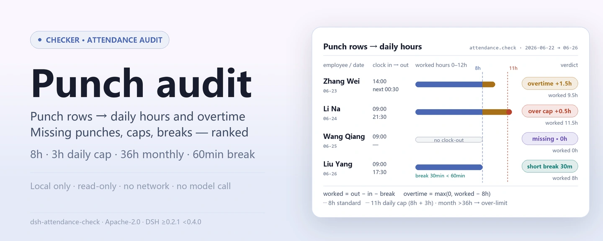
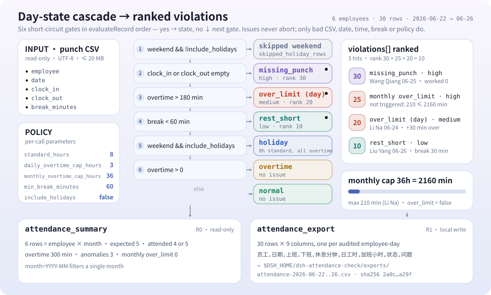
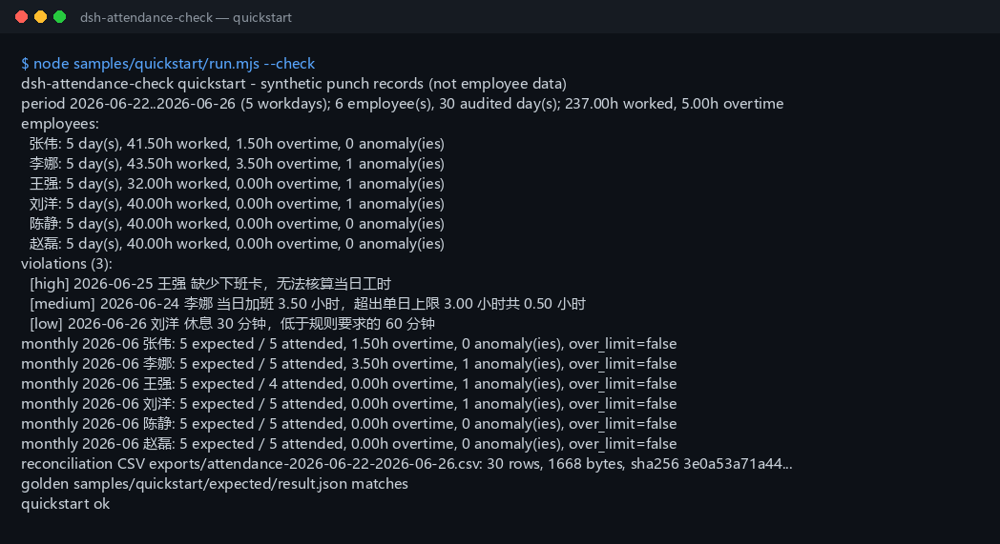

<div align="center">

<picture>
  <source media="(prefers-color-scheme: dark)" srcset="docs/assets/dsh-attendance-check-hero-en-dark.webp">
  
</picture>

# dsh-attendance-check

**Convierte un CSV de fichajes en horas diarias, horas extra, días fuera de límite, fichajes faltantes y descansos insuficientes por empleado; después resume el mes y exporta un CSV de conciliación.**

Una herramienta de auditoría de asistencia puramente local para DeepSeek Harness: lee el CSV de fichajes que indiques y audita cada día contra una jornada estándar de 8 horas, un tope de 3 horas extra diarias y un tope de 36 horas extra mensuales — sin red, sin llamadas a modelos y sin carga de datos.

[Instalar](#instalación-en-tres-pasos) · [Configuración](#configuración) · [FAQ](#faq) · [简体中文](README.md) · [English](README.en.md) · [Español](README.es.md) · [Português](README.pt.md) · [हिन्दी](README.hi.md)

[](LICENSE)
[](#compatibilidad)
[](https://www.npmjs.com/package/dsh-attendance-check)
[](https://github.com/PerryLink/dsh-attendance-check/actions/workflows/ci.yml)
[](#compatibilidad)

[](https://github.com/PerryLink/dsh-attendance-check/stargazers)
[](https://www.npmjs.com/package/dsh-attendance-check)
[](https://dshfind.com/plugins/PerryLink/dsh-attendance-check?ref=badge)
[](https://gitee.com/perrylink/dsh-attendance-check)

```sh
dsh plugin --profile <profile> add dsh-attendance-check
```

</div>

<sub>Plugin de la comunidad, no afiliado a DeepSeek. Repositorio canónico: <https://github.com/PerryLink/dsh-attendance-check> (Gitee es un espejo). Estado: alpha / sintético-público / parcial / not counted / no GA — sin datos de empleados ni evidencia de clientes, y sin declaraciones de producción, liquidación salarial, legales o de auditoría.</sub>

## Qué es

Importa un registro local de fichajes (empleado, fecha, hora de entrada, hora de salida, minutos de descanso), lo audita contra una jornada estándar de 8 horas, un tope de 3 horas extra diarias y un tope de 36 horas extra mensuales, y obtiene las horas diarias, horas extra, días fuera de límite, fichajes faltantes y descansos insuficientes de cada empleado, una lista de infracciones ordenada por gravedad, un resumen mensual y un CSV de conciliación. Todo se ejecuta en tu máquina; el archivo fuente es de solo lectura y nunca se modifica.

- **Sirve para:** decenas hasta decenas de miles de filas de fichajes; revisar horas diarias y horas extra antes de la nómina; encontrar empleados por encima del tope diario de 3 horas o del tope mensual de 36 horas; convertir fichajes faltantes, descansos insuficientes y días fuera de límite en una lista de seguimiento; entregar a RR. HH. o finanzas un CSV de conciliación revisable; turnos que cruzan la medianoche escritos como `次日 HH:MM` o `24:00+`.
- **No sirve para:** planificación de turnos, aprobación de horas extra ni reemplazar un sistema de control horario; un calendario de festivos oficiales (solo se reconocen sábado y domingo); varios pares de fichajes por día; conversión de permisos, días compensatorios, viajes o trabajo de campo; cálculo de salarios, pago de horas extra, impuestos o seguridad social; PDF, escaneos o Excel como entrada directa (exporta primero a CSV); sincronizar un dispositivo de fichaje o subir datos de empleados.

<picture>
  <source media="(prefers-color-scheme: dark)" srcset="docs/assets/dsh-attendance-check-flow-v5-dark.svg">
  
</picture>

## Instalación en tres pasos

1. **Instala** (elige un canal):

   ```sh
   # canal npm (recomendado, versiones publicadas)
   dsh plugin --profile <profile> add dsh-attendance-check
   # canal git (main más reciente)
   dsh plugin --profile <profile> add github:PerryLink/dsh-attendance-check
   # canal tarball: pnpm pack en este repo y después
   dsh plugin --profile <profile> add ./dsh-attendance-check-<version>.tgz
   ```

2. **Verifica que está activo**:

   ```sh
   dsh --profile <profile> --dump-config | grep dsh-attendance-check
   ```

3. **Ejecuta el ejemplo incluido** (6 empleados × 5 días laborables de datos sintéticos, comparado con el archivo dorado):

   ```sh
   node samples/quickstart/run.mjs --check
   ```

**Desinstalar:** `dsh plugin --profile <profile> remove dsh-attendance-check`.

## Capacidades clave

Los nombres de las herramientas son API estable; las descripciones se mantienen en inglés para coincidir con la salida en tiempo de ejecución.

| Herramienta | Propósito | Riesgo |
|---|---|---|
| `attendance.check` | Lee el CSV de fichajes y audita cada día: horas diarias, horas extra, días fuera de límite, fichajes faltantes, descansos insuficientes y una lista de infracciones ordenada por gravedad | R0 (solo lectura) |
| `attendance.summary` | Resume por empleado-mes los días esperados/asistidos, horas extra, número de anomalías y la marca de exceso mensual | R0 (solo lectura) |
| `attendance.export` | Escribe el CSV de conciliación a nivel de día (empleado/fecha/entrada/salida/descanso/horas/extra/estado/incidencia), devolviendo ruta y sha256 | R1 (escritura local solo en exports) |

- **Auditoría diaria:** horas del día = salida − entrada − descanso; los turnos que cruzan la medianoche (`次日 HH:MM` o `24:00+`) se computan en el día siguiente.
- **Detección de excesos:** más de 3 horas extra en un día marca el día `over_limit` (medium); más de 36 horas extra en el mes marca ese empleado-mes `over_limit` (high).
- **Fichajes faltantes y descansos cortos:** un fichaje faltante es una incidencia, no un error; un descanso por debajo de 60 minutos marca el día `rest_short`.
- **Resumen mensual:** una fila por empleado-mes con días esperados, días asistidos, horas extra totales y la marca de exceso mensual.
- **Entregable revisable:** el CSV de conciliación exportado usa cabeceras en chino y vuelve con un recibo `sha256`.

## Ejemplo

Pega esta línea en el agente:

> 我有这份 6 名员工 5 个工作日的打卡明细，用 8 小时标准工时、单日加班上限 3 小时、月加班上限 36 小时核对，输出异常清单并导出核对表 CSV。

Reproduce el ejemplo incluido y compáralo con el archivo dorado:

```sh
node samples/quickstart/run.mjs --check
```



El ejemplo son 6 empleados × 5 días laborables (del 2026-06-22 al 2026-06-26), 30 fichajes sintéticos: 2 días con horas extra (Zhang Wei trabaja 1.5 h cruzando la medianoche; Li Na trabaja 3.5 h y supera el tope diario por 0.5 h), 1 fichaje faltante (Wang Qiang no tiene salida) y 1 descanso insuficiente (Liu Yang solo descansa 30 minutos). `samples/quickstart/expected/result.json` es la salida real de `node samples/quickstart/run.mjs --json`, no escrita a mano; la captura es la salida real de terminal de `--check` (captura cruda en [`docs/assets/quickstart.log`](docs/assets/quickstart.log)).

## Entrada

- CSV UTF-8 con fila de cabecera y separador de comas. Se admiten comillas RFC 4180, saltos de línea incrustados, CRLF y BOM UTF-8.
- Cabecera: `employee,date,clock_in,clock_out,break_minutes`. También funcionan los alias chinos (`员工 / 姓名 / 日期 / 上班时间 / 下班时间 / 休息分钟`); la comparación no distingue mayúsculas y las columnas extra se ignoran.
- Fechas: `date` debe ser un `YYYY-MM-DD` real. Una fila por empleado y día; los duplicados son `E_ATT_CSV_ROW`.
- Horas: `HH:MM` (00:00–23:59). Para cruzar la medianoche usa `次日 01:30`, `次日01:30`, o las horas extendidas `24:00`–`29:59` (la forma `24:00+`); la salida debe ser posterior a la entrada y un turno no puede superar 24 horas. Los formatos incorrectos son `E_ATT_TIME_INVALID`.
- Fichajes faltantes: `clock_in` o `clock_out` pueden estar vacíos. Un valor vacío se convierte en una **incidencia** `E_ATT_MISSING_PUNCH`, no en una interrupción.
- Minutos de descanso: entero 0–1440; vacío significa 0; debe ser menor que la duración del turno. Los valores incorrectos son `E_ATT_BREAK_INVALID`.
- Tamaño: hasta 20 MB por archivo; por encima, divide por empleado o por mes.
- Fuente: el CSV local que indica el usuario; es de solo lectura y nunca se modifica.

## Salida

- **`attendance.check`**: `{ period, source_sha256, policy, employees, violations, totals }`.
  - `period`: fechas cubiertas, días laborables lunes–viernes dentro del tramo, meses tocados.
  - `policy`: las reglas usadas (horas estándar, tope diario, tope mensual, descanso mínimo, festivos incluidos).
  - `employees[]`: por empleado, `days[]` (fecha, día de semana, fichajes, descanso, minutos trabajados, horas extra, marca de festivo, marca de cruce de medianoche, lado faltante, estado, códigos de incidencia), `worked_minutes`, `overtime_minutes`, `over_limit_days`, `over_limit_months`, `missing_punches`, `rest_short_days`, `skipped_holiday_days` y `monthly_overtime[]`.
  - `violations[]`: infracciones ordenadas por gravedad con `severity`, `rank`, `kind`, `scope`, `code`, `employee`, `date`/`month`, `minutes` y un `message` en chino.
  - `totals`: empleados, días auditados, filas de fin de semana omitidas, minutos trabajados y extra, días/meses fuera de límite, fichajes faltantes, días con descanso insuficiente e infracciones totales.
- **`attendance.summary`**: `{ period, source_sha256, policy, rows, totals }`. Una fila por empleado-mes: `expected_days`, `attended_days`, `overtime_minutes` / `overtime_hours`, `anomaly_count`, `missing_punches`, `rest_short_days`, `over_limit_days` y `over_limit` (horas extra mensuales por encima de 36 h). Filtro opcional `month=YYYY-MM`.
- **`attendance.export`**: escribe el CSV de conciliación a nivel de día en `$DSH_HOME/dsh-attendance-check/exports/` con las columnas `员工,日期,上班,下班,休息分钟,日工时,加班小时,状态,问题`; devuelve ruta, `sha256`, bytes y número de filas. El nombre de archivo solo admite `[A-Za-z0-9._-]`.

## Reglas

1. Horas del día = salida − entrada − descanso; las horas que cruzan la medianoche se computan en el día siguiente.
2. Horas extra de un día laborable = max(0, minutos del día − minutos estándar); el estándar por defecto es 8 horas.
3. Más de 3 horas extra en un día marca el día `over_limit` con gravedad `medium`.
4. Más de 36 horas extra en el mes marca ese empleado-mes `over_limit` con gravedad `high`; se activan tanto `monthly_overtime[]` como la marca `over_limit` del resumen.
5. Entrada o salida vacía marca el día `missing_punch`, cuenta 0 minutos trabajados y emite `E_ATT_MISSING_PUNCH` como **incidencia**, nunca como error lanzado.
6. Un descanso por debajo del mínimo (60 minutos por defecto) marca el día `rest_short` y emite `E_ATT_REST_SHORT`.
7. Las filas de sábado/domingo se omiten por defecto (contadas en `skipped_holiday_rows`). Con `include_holidays=true`, las filas de fin de semana se auditan como trabajo festivo: tiempo estándar 0, todos los minutos trabajados cuentan como horas extra y el tope diario sigue aplicando.
8. Orden de gravedad: fichaje faltante (30) > exceso mensual (25) > exceso diario (20) > descanso insuficiente (10); los empates se resuelven por fecha, orden de empleado y tipo.
9. Días esperados = días lunes–viernes del tramo cubierto de ese mes; días asistidos = días con ambos fichajes. No hay calendario de festivos oficiales integrado.
10. El tope mensual se aplica a los datos presentes en el archivo; no rellena el resto del mes.

## Configuración

Este plugin no tiene claves de configuración a nivel de perfil (`cordis.patch.yml` solo inserta el propio plugin); cada regla se pasa como argumento de herramienta en cada llamada, y las tres herramientas comparten los mismos parámetros de política:

| Parámetro | Valor por defecto | Significado |
|---|---|---|
| `path` | (obligatorio) | CSV de fichajes local a auditar; solo lectura, nunca se modifica |
| `standard_hours` | `8` | Horas estándar por día, rango 1–24 |
| `daily_overtime_cap_hours` | `3` | Tope de horas extra diarias, rango 0–24 |
| `monthly_overtime_cap_hours` | `36` | Tope de horas extra mensuales, rango 0–744 |
| `min_break_minutes` | `60` | Minutos mínimos de descanso, entero 0–720 |
| `include_holidays` | `false` | Con `true`, las filas de fin de semana se auditan como trabajo festivo: tiempo estándar 0, todos los minutos trabajados cuentan como horas extra y el tope diario sigue aplicando |
| `month` | (vacío) | Solo `attendance.summary`: `YYYY-MM`, mirar un único mes |
| `filename` | derivado del periodo | Solo `attendance.export`: nombre del archivo exportado, solo `[A-Za-z0-9._-]` |

## FAQ

<details>
<summary>¿Cómo escribo un turno que cruza la medianoche?</summary>

Escribe `次日 01:30` (con o sin espacio) o la forma extendida `25:30`; son equivalentes. Un simple `01:30` se interpreta como la madrugada del mismo día, anterior a la entrada, y lanza `E_ATT_TIME_INVALID`. Un turno de más de 24 horas lanza el mismo código.

</details>

<details>
<summary>¿Por qué un fichaje faltante no es un error?</summary>

Los fichajes faltantes son habituales en datos de asistencia reales y un solo fichaje faltante no debería tumbar toda la conciliación. Se registra como un día `missing_punch` más una incidencia `E_ATT_MISSING_PUNCH`, con 0 minutos trabajados y 0 horas extra; `attendance.check` sigue devolviendo los resultados de los demás para que RR. HH. corrija el fichaje y repita. Solo abortan la llamada CSV, fechas, horas, descansos o reglas mal formados.

</details>

<details>
<summary>¿Cómo se decide el tope mensual de 36 horas?</summary>

Los minutos extra se suman por empleado y mes natural sobre los días auditados; por encima de 2160 minutos `over_limit=true`, y se emite una infracción `scope=month`, `severity=high` cuyo `minutes` es el exceso. Si el archivo cubre solo medio mes, solo se cuentan los datos auditados; la herramienta no extrapola.

</details>

<details>
<summary>¿Cómo se tratan los fines de semana y los festivos?</summary>

No hay calendario de festivos oficiales: solo se reconocen sábado y domingo como días de descanso. Las filas de fin de semana se omiten por defecto; pasa `include_holidays=true` para auditar el trabajo en fin de semana, donde todos los minutos trabajados cuentan como horas extra y el tope diario sigue aplicando. Marca o elimina primero los festivos oficiales entre semana en los datos fuente.

</details>

<details>
<summary>¿Qué son los días esperados y los días asistidos?</summary>

Los días esperados son los días lunes–viernes dentro del tramo cubierto del archivo para ese mes (el tramo va de la fecha auditada más temprana a la más tardía entre todos los empleados). Los días asistidos son los días con ambos fichajes presentes para ese empleado. Un día con fichaje faltante no cuenta como asistido, pero aparece en `missing_punches` y en la lista de infracciones.

</details>

<details>
<summary>¿Modifica o sube mi archivo?</summary>

No. Lee el CSV indicado, escribe solo en `$DSH_HOME/dsh-attendance-check/exports/` y nunca usa la red, una llamada a modelo ni una subida. El CSV fuente no se modifica.

</details>

## Permisos y datos

- Lectura: el CSV de fichajes que indica el usuario (ejemplo: `samples/quickstart/input/attendance-2026-06.csv`); nada más.
- Escritura: solo `$DSH_HOME/dsh-attendance-check/exports/` (el CSV de conciliación); el archivo fuente no se modifica.
- Red: no.
- Sistemas externos: ninguno.

`attendance.check` y `attendance.summary` son **R0** (solo lectura). `attendance.export` es **R1** (escritura local solo en la carpeta exports). `DSH_ATTENDANCE_CHECK_HOME` sobrescribe la raíz de escritura local para las pruebas; el valor por defecto es exactamente `$DSH_HOME/dsh-attendance-check`.

## Errores

El formato del mensaje es `<una frase>（E_ATT_XXX）｜下一步：<una acción>｜细节：<opcional>`. Los primeros siete códigos se lanzan; los tres últimos son códigos de incidencia que solo aparecen en `violations`.

| Código | Cuándo | Siguiente paso |
|---|---|---|
| `E_ATT_CSV_ROW` | Número de columnas incorrecto, cabecera ausente/duplicada, empleado vacío, empleado-día duplicado, archivo > 20 MB | Corrige la fila indicada; una fila por empleado y día |
| `E_ATT_DATE_INVALID` | `date` o `month` no es una fecha/mes real | Usa `2026-06-22` / `2026-06` |
| `E_ATT_TIME_INVALID` | No es `HH:MM`, forma de cruce de medianoche incorrecta, salida no posterior a la entrada, turno > 24 h | Usa `09:00`; cruza la medianoche con `次日 01:30` o `25:30` |
| `E_ATT_BREAK_INVALID` | El descanso no es un entero 0–1440 o consume todo el turno | Minutos enteros menores que la duración del turno |
| `E_ATT_POLICY_INVALID` | Horas estándar, topes o descanso mínimo fuera de rango | Estándar 1–24 h, diario 0–24 h, mensual 0–744 h, descanso 0–720 minutos enteros |
| `E_ATT_PATH_INVALID` | Entrada ausente/directorio/ilegible o nombre de exportación inseguro | Pasa un CSV existente; exporta solo con `[A-Za-z0-9._-]` |
| `E_ATT_EMPTY` | Archivo vacío, solo cabecera, todo fines de semana sin `include_holidays`, o filtro de mes sin datos | Revisa las fechas e `include_holidays`; elige un mes con datos |
| `E_ATT_MISSING_PUNCH` (incidencia) | Entrada o salida vacía | Corrige el fichaje y repite; el día cuenta 0 horas por ahora |
| `E_ATT_OVER_LIMIT` (incidencia) | Tope diario superado (`scope=day`) o tope mensual superado (`scope=month`) | Revisa la aprobación de horas extra y la planificación de compensaciones |
| `E_ATT_REST_SHORT` (incidencia) | Descanso por debajo del mínimo de la política | Revisa el registro de descansos o ajusta `min_break_minutes` |

Consulta [TROUBLESHOOTING.md](TROUBLESHOOTING.md).

## Limitaciones conocidas

- **Sin calendario de festivos:** solo se reconocen sábado/domingo; los festivos oficiales y los días compensatorios deben prepararse en los datos fuente.
- **Un par de fichajes por día:** sin fichajes multisegmento ni registros separados de inicio/fin de horas extra; consolídalos primero en el sistema de origen.
- **Sin tipos de permiso:** permisos, días compensatorios, viajes, trabajo de campo y ausencias no se convierten; un fichaje faltante es solo una incidencia.
- **Sin nómina:** sin pago de horas extra, multiplicadores, impuestos ni seguridad social; el paquete solo informa horas y resultados de conciliación.
- **Tope mensual limitado a los datos:** si el archivo cubre parte de un mes, el tope de 36 horas se aplica solo a los datos auditados.
- Solo CSV: sin PDF, escaneos ni Excel, y sin OCR.
- El CSV exportado usa solo comillas RFC 4180; los prefijos de fórmula de Excel no se sanea.
- Solo local: sin red, sin llamadas a modelos, sin subida.
- Solo muestras públicas/sintéticas; alpha/parcial, not counted, sin declaración de producción ni cumplimiento.

## Evidencia de aceptación

Los accesorios públicos/sintéticos viven en `samples/quickstart/`; `ACCEPTANCE.csv` registra 17 comprobaciones de herramientas más una fila dorada de quickstart (18 filas). Todas las filas son `counted=false` excepto la de quickstart.

| req_id | metric | threshold | actual | pass | source | counted |
|---|---|---|---|---|---|---|
| AC-A01 | daily audit totals | employees=6 days=30 overtime=300 | employees=6 days=30 overtime=300 | true | public/synthetic | false |
| AC-A04 | daily overtime cap | overtime=210 status=over_limit | overtime=210 status=over_limit | true | public/synthetic | false |
| AC-A07 | monthly summary | rows=6 expected=30 attended=29 | rows=6 expected=30 attended=29 | true | public/synthetic | false |
| AC-A09 | monthly cap over_limit | monthly=2340 over=180 | monthly=2340 over=180 | true | public/synthetic | false |
| AC-A10 | reconciliation CSV | rows=30 lines=31 hash=ok | rows=30 lines=31 hash=ok | true | public/synthetic | false |
| PS1-QS01 | quickstart golden | 1/1 | 1 | true | synthetic/quickstart | true |

*Filas respaldadas por accesorios, no datos de empleados ni clientes; ninguna salida está inventada.* Consulta [EVIDENCE.md](EVIDENCE.md) para el entorno y los resultados por comando; las ejecuciones de evidencia anteriores viven en `evidence/`.

## Compatibilidad

| Superficie | Estado |
|---|---|
| Harness | `dsh >=0.2.1-rc.3 <0.4.0` |
| Node | `>=24.9.0 <25` |
| Plataformas | Todas; solo archivos locales |
| Datos | Sin red, sin llamadas a modelos, sin subida |

## Ecosistema y calidad

- [Espejo de Gitee](https://gitee.com/perrylink/dsh-attendance-check) (espejo sincronizado; GitHub es el canónico)
- [Página del plugin en dshfind](https://dshfind.com/plugins/PerryLink/dsh-attendance-check) (instalaciones y clasificación)
- [Índice de dominio](https://perrylink.github.io/dsh-plugins/) (el catálogo de plugins de PerryLink)
- Plugins relacionados de la familia: [dsh-ar-aging](https://github.com/PerryLink/dsh-ar-aging) (antigüedad de cuentas por cobrar), [dsh-policy-ledger](https://github.com/PerryLink/dsh-policy-ledger) (libro de políticas)

## Desarrollo

```sh
pnpm install --frozen-lockfile
pnpm build && pnpm lint && pnpm typecheck
node --test test/*.test.mjs
node scripts/gate.mjs
```

Versión actual `0.1.0` · 134 pruebas superadas (`node --test test/*.test.mjs`). Las imágenes del README se generan programáticamente con [`scripts/gen-readme-assets.py`](scripts/gen-readme-assets.py) (Python: el hero se dibuja con Pillow y el diagrama de estructura es un SVG escrito a mano; ambos en variante clara y oscura) y puede reejecutarse en cualquier momento.

Topics: `deepseek-harness`, `dsh`, `dsh-plugin`, `attendance`, `overtime`, `timesheet`, `punch-clock`, `payroll`, `hr`, `csv`, `perrylink`

## Familia y agradecimientos

Este proyecto es miembro de la familia de plugins de DeepSeek Harness mantenida por [PerryLink](https://github.com/PerryLink) (todos Apache-2.0). Si este plugin te ayuda, **una estrella facilita que la siguiente persona lo encuentre** — nada está bloqueado tras ella.

- [@PerryLink](https://github.com/PerryLink) — creador y mantenedor: la canalización de auditoría del CSV de fichajes, las tres herramientas `attendance.check` / `attendance.summary` / `attendance.export`, el ejemplo dorado de quickstart con su evidencia de aceptación y la documentación en cinco idiomas.

## Licencia

[LICENSE](LICENSE) (Apache License 2.0) © 2026 dsh-attendance-check contributors. Consulta también `NOTICE` y `THIRD-PARTY-NOTICES`.

<p align="center"><sub>Apache-2.0 · Plugin de la comunidad, no afiliado a DeepSeek.</sub></p>
