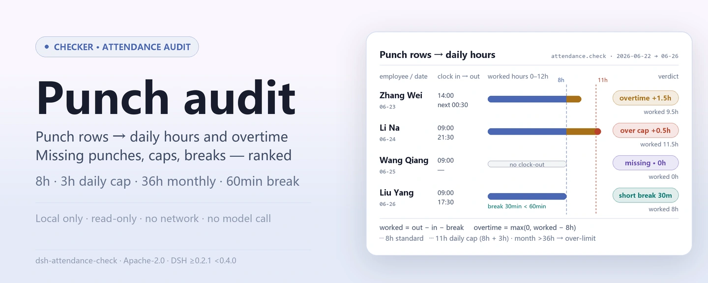
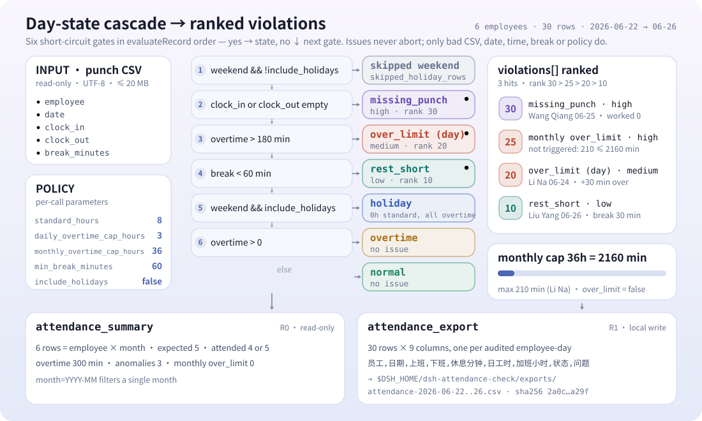
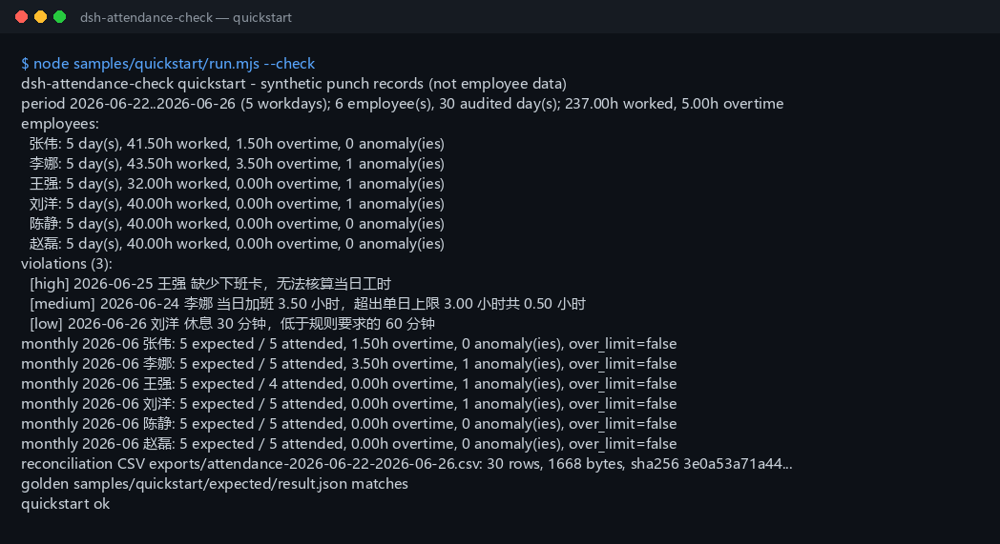

<div align="center">

<picture>
  <source media="(prefers-color-scheme: dark)" srcset="docs/assets/dsh-attendance-check-hero-en-dark.webp">
  
</picture>

# dsh-attendance-check

**पंच-क्लॉक CSV को प्रति-कर्मचारी दैनिक घंटे, ओवरटाइम, सीमा से अधिक दिन, गायब पंच और छोटे ब्रेक में बदलें, फिर महीने का सारांश बनाएं और समाधान CSV एक्सपोर्ट करें।**

DeepSeek Harness के लिए पूरी तरह लोकल उपस्थिति ऑडिट टूल: आपके बताए पंच CSV को पढ़कर हर दिन को 8 घंटे के मानक कार्यदिवस, 3 घंटे की दैनिक ओवरटाइम सीमा और 36 घंटे की मासिक ओवरटाइम सीमा के विरुद्ध जांचता है — बिना नेटवर्क, बिना मॉडल कॉल, बिना अपलोड।

[इंस्टॉल](#तीन-चरणों-में-शुरुआत) · [कॉन्फ़िगरेशन](#कॉन्फ़िगरेशन) · [FAQ](#faq) · [简体中文](README.md) · [English](README.en.md) · [Español](README.es.md) · [Português](README.pt.md) · [हिन्दी](README.hi.md)

[](LICENSE)
[](#संगतता)
[](https://www.npmjs.com/package/dsh-attendance-check)
[](https://github.com/PerryLink/dsh-attendance-check/actions/workflows/ci.yml)
[](#संगतता)

[](https://github.com/PerryLink/dsh-attendance-check/stargazers)
[](https://www.npmjs.com/package/dsh-attendance-check)
[](https://dshfind.com/plugins/PerryLink/dsh-attendance-check?ref=badge)
[](https://gitee.com/perrylink/dsh-attendance-check)

```sh
dsh plugin --profile <profile> add dsh-attendance-check
```

</div>

<sub>सामुदायिक प्लगइन, DeepSeek से असंबद्ध। कैनोनिकल रिपॉज़िटरी: <https://github.com/PerryLink/dsh-attendance-check> (Gitee एक मिरर है)। स्थिति: alpha / सार्वजनिक-सिंथेटिक / आंशिक / not counted / GA नहीं — कोई कर्मचारी डेटा या ग्राहक साक्ष्य नहीं, और उत्पादन-तैयारी, वेतन-निपटान, कानूनी या लेखापरीक्षा दावा नहीं।</sub>

## यह क्या है

लोकल पंच रजिस्टर (कर्मचारी, तारीख, आने का समय, जाने का समय, ब्रेक मिनट) इम्पोर्ट करें, उसे 8 घंटे के मानक कार्यदिवस, 3 घंटे की दैनिक ओवरटाइम सीमा और 36 घंटे की मासिक ओवरटाइम सीमा से जांचें, और हर कर्मचारी के दैनिक घंटे, ओवरटाइम, सीमा से अधिक दिन, गायब पंच और छोटे ब्रेक, गंभीरता-क्रमित उल्लंघन सूची, मासिक सारांश तथा समाधान CSV पाएं। सब कुछ आपकी मशीन पर चलता है; स्रोत फ़ाइल केवल-पठनीय है और कभी संशोधित नहीं होती।

- **उपयुक्त:** दर्जनों से लेकर हज़ारों पंच पंक्तियाँ; पेरोल से पहले दैनिक घंटे और ओवरटाइम की जांच; 3 घंटे की दैनिक सीमा या 36 घंटे की मासिक सीमा से ऊपर के कर्मचारियों को खोजना; गायब पंच, छोटे ब्रेक और सीमा-अधिक दिनों को फॉलो-अप सूची में बदलना; HR या फाइनेंस को समीक्षा योग्य समाधान CSV देना; `次日 HH:MM` या `24:00+` लिखी आधी-रात पार पाली की गणना।
- **अनुपयुक्त:** शिफ़्ट शेड्यूलिंग, ओवरटाइम अनुमोदन या टाइम-एंड-अटेंडेंस सिस्टम की जगह; सरकारी अवकाश कैलेंडर (केवल शनिवार/रविवार मान्य); प्रतिदिन कई पंच जोड़े; छुट्टी, कम्प-टाइम, दौरे या फ़ील्ड-वर्क रूपांतरण; वेतन, ओवरटाइम-भुगतान, कर या सामाजिक-सुरक्षा गणना; PDF, स्कैन या Excel सीधे इनपुट (पहले CSV निकालें); पंच डिवाइस सिंक करना या कर्मचारी डेटा अपलोड करना।

<picture>
  <source media="(prefers-color-scheme: dark)" srcset="docs/assets/dsh-attendance-check-flow-v5-dark.svg">
  
</picture>

## तीन चरणों में शुरुआत

1. **इंस्टॉल करें** (कोई एक चैनल चुनें):

   ```sh
   # npm चैनल (अनुशंसित, प्रकाशित संस्करण)
   dsh plugin --profile <profile> add dsh-attendance-check
   # git चैनल (नवीनतम main)
   dsh plugin --profile <profile> add github:PerryLink/dsh-attendance-check
   # tarball चैनल: इस रेपो में pnpm pack करके
   dsh plugin --profile <profile> add ./dsh-attendance-check-<version>.tgz
   ```

2. **सक्रिय होने की पुष्टि करें**:

   ```sh
   dsh --profile <profile> --dump-config | grep dsh-attendance-check
   ```

3. **बंडल नमूना चलाएँ** (6 कर्मचारी × 5 कार्यदिवस सिंथेटिक डेटा, गोल्डन फ़ाइल से तुलना):

   ```sh
   node samples/quickstart/run.mjs --check
   ```

**अनइंस्टॉल:** `dsh plugin --profile <profile> remove dsh-attendance-check`.

## मुख्य क्षमताएँ

टूल नाम स्थिर API हैं; रनटाइम आउटपुट से मेल के लिए विवरण अंग्रेज़ी में रखे गए हैं।

| टूल | उद्देश्य | जोखिम |
|---|---|---|
| `attendance_check` | पंच CSV पढ़कर हर दिन ऑडिट करता है: दैनिक घंटे, ओवरटाइम, सीमा-अधिक दिन, गायब पंच, छोटे ब्रेक और गंभीरता-क्रमित उल्लंघन सूची | R0 (केवल-पठन) |
| `attendance_summary` | प्रति कर्मचारी-माह अपेक्षित/उपस्थित दिन, ओवरटाइम, विसंगति संख्या और मासिक अधिकता फ़्लैग संक्षेपित करता है | R0 (केवल-पठन) |
| `attendance_export` | दिन-स्तरीय समाधान CSV (कर्मचारी/तारीख/आगमन/प्रस्थान/ब्रेक/घंटे/ओवरटाइम/स्थिति/समस्या) लिखता है, पथ और sha256 लौटाता है | R1 (केवल exports में लोकल राइट) |

- **दिन-स्तरीय ऑडिट:** दैनिक घंटे = जाने का समय − आने का समय − ब्रेक; आधी-रात पार पालियाँ (`次日 HH:MM` या `24:00+`) अगले दिन गिनी जाती हैं।
- **सीमा-अधिकता पहचान:** 3 घंटे से अधिक दैनिक ओवरटाइम दिन को `over_limit` (medium) चिह्नित करता है; 36 घंटे से अधिक मासिक ओवरटाइम उस कर्मचारी-माह को `over_limit` (high) चिह्नित करता है।
- **गायब पंच और छोटे ब्रेक:** गायब पंच एक issue है, error नहीं; 60 मिनट से कम ब्रेक दिन को `rest_short` चिह्नित करता है।
- **मासिक सारांश:** प्रति कर्मचारी-माह एक पंक्ति — अपेक्षित दिन, उपस्थित दिन, कुल ओवरटाइम और मासिक अधिकता फ़्लैग।
- **समीक्षा योग्य डिलिवरेबल:** एक्सपोर्ट की गई समाधान CSV चीनी हेडर वाली होती है और `sha256` रसीद के साथ लौटती है।

## उदाहरण

यह एक पंक्ति एजेंट में पेस्ट करें:

> 我有这份 6 名员工 5 个工作日的打卡明细，用 8 小时标准工时、单日加班上限 3 小时、月加班上限 36 小时核对，输出异常清单并导出核对表 CSV。

बंडल नमूना दोहराएँ और गोल्डन फ़ाइल से तुलना करें:

```sh
node samples/quickstart/run.mjs --check
```



नमूना 6 कर्मचारी × 5 कार्यदिवस (2026-06-22 से 2026-06-26), 30 सिंथेटिक पंच पंक्तियाँ है: 2 ओवरटाइम दिन (Zhang Wei आधी रात पार 1.5 घंटे काम करता है; Li Na 3.5 घंटे काम करके दैनिक सीमा 0.5 घंटे से पार करती है), 1 गायब पंच (Wang Qiang के पास जाने की पंच नहीं) और 1 छोटा ब्रेक (Liu Yang केवल 30 मिनट लेता है)। `samples/quickstart/expected/result.json`, `node samples/quickstart/run.mjs --json` का वास्तविक stdout है, हाथ से लिखा नहीं; स्क्रीनशॉट `--check` का वास्तविक टर्मिनल आउटपुट है (कच्चा कैप्चर [`docs/assets/quickstart.log`](docs/assets/quickstart.log) में)।

## इनपुट

- UTF-8 CSV, हेडर पंक्ति और कॉमा विभाजक के साथ। RFC 4180 उद्धरण, एम्बेडेड न्यूलाइन, CRLF और UTF-8 BOM समर्थित हैं।
- हेडर: `employee,date,clock_in,clock_out,break_minutes`। चीनी उपनाम (`员工 / 姓名 / 日期 / 上班时间 / 下班时间 / 休息分钟`) भी चलते हैं; मिलान केस-असंवेदनशील है और अतिरिक्त कॉलम अनदेखे जाते हैं।
- तारीखें: `date` वास्तविक `YYYY-MM-DD` होनी चाहिए। प्रति कर्मचारी प्रति दिन एक पंक्ति; डुप्लिकेट `E_ATT_CSV_ROW` हैं।
- समय: `HH:MM` (00:00–23:59)। आधी रात पार के लिए `次日 01:30`, `次日01:30`, या विस्तारित घंटे `24:00`–`29:59` (`24:00+` रूप) लिखें; जाने का समय आने के समय से बाद होना चाहिए और एक पाली 24 घंटे से अधिक नहीं हो सकती। गलत प्रारूप `E_ATT_TIME_INVALID` हैं।
- गायब पंच: `clock_in` या `clock_out` खाली हो सकता है। खाली मान `E_ATT_MISSING_PUNCH` **issue** बनता है, abort नहीं।
- ब्रेक मिनट: पूर्णांक 0–1440; खाली का अर्थ 0; पाली की अवधि से कम होना चाहिए। गलत मान `E_ATT_BREAK_INVALID` हैं।
- आकार: प्रति फ़ाइल 20 MB तक; अधिक होने पर कर्मचारी या माह के हिसाब से बाँटें।
- स्रोत: उपयोगकर्ता की बताई लोकल CSV; केवल-पठनीय, कभी संशोधित नहीं होती।

## आउटपुट

- **`attendance_check`**: `{ period, source_sha256, policy, employees, violations, totals }`।
  - `period`: कवर की गई तारीखें, उस अवधि के सोमवार–शुक्रवार कार्यदिवस, छुए गए महीने।
  - `policy`: उपयोग की गई नियमावली (मानक घंटे, दैनिक सीमा, मासिक सीमा, न्यूनतम ब्रेक, अवकाश सम्मिलित)।
  - `employees[]`: प्रति कर्मचारी, `days[]` (तारीख, वार, पंच, ब्रेक, काम के मिनट, ओवरटाइम, अवकाश फ़्लैग, आधी-रात-पार फ़्लैग, गायब पक्ष, स्थिति, issue कोड), `worked_minutes`, `overtime_minutes`, `over_limit_days`, `over_limit_months`, `missing_punches`, `rest_short_days`, `skipped_holiday_days` और `monthly_overtime[]`।
  - `violations[]`: गंभीरता-क्रमित उल्लंघन — `severity`, `rank`, `kind`, `scope`, `code`, `employee`, `date`/`month`, `minutes` और चीनी `message`।
  - `totals`: कर्मचारी, ऑडिट किए दिन, छोड़ी गई सप्ताहांत पंक्तियाँ, काम और ओवरटाइम मिनट, सीमा-अधिक दिन/माह, गायब पंच, छोटे-ब्रेक दिन और कुल उल्लंघन।
- **`attendance_summary`**: `{ period, source_sha256, policy, rows, totals }`। प्रति कर्मचारी-माह एक पंक्ति: `expected_days`, `attended_days`, `overtime_minutes` / `overtime_hours`, `anomaly_count`, `missing_punches`, `rest_short_days`, `over_limit_days` और `over_limit` (मासिक ओवरटाइम 36 घंटे से ऊपर)। वैकल्पिक `month=YYYY-MM` फ़िल्टर।
- **`attendance_export`**: दिन-स्तरीय समाधान CSV को `$DSH_HOME/dsh-attendance-check/exports/` में कॉलम `员工,日期,上班,下班,休息分钟,日工时,加班小时,状态,问题` के साथ लिखता है; पथ, `sha256`, बाइट्स और पंक्ति संख्या लौटाता है। फ़ाइल नाम केवल `[A-Za-z0-9._-]` हो सकता है।

## नियम

1. दैनिक घंटे = जाने का समय − आने का समय − ब्रेक; आधी-रात-पार समय अगले दिन गिना जाता है।
2. कार्यदिवस ओवरटाइम = max(0, दैनिक मिनट − मानक मिनट); डिफ़ॉल्ट मानक 8 घंटे है।
3. 3 घंटे की सीमा से अधिक दैनिक ओवरटाइम दिन को `over_limit`, गंभीरता `medium` चिह्नित करता है।
4. 36 घंटे की सीमा से अधिक मासिक ओवरटाइम उस कर्मचारी-माह को `over_limit`, गंभीरता `high` चिह्नित करता है; `monthly_overtime[]` और summary का `over_limit` फ़्लैग दोनों सेट होते हैं।
5. आने या जाने की पंच खाली होने पर दिन `missing_punch` चिह्नित होता है, 0 काम के मिनट गिने जाते हैं, और `E_ATT_MISSING_PUNCH` **issue** के रूप में निकलता है — कभी thrown error नहीं।
6. न्यूनतम (डिफ़ॉल्ट 60 मिनट) से कम ब्रेक दिन को `rest_short` चिह्नित करता है और `E_ATT_REST_SHORT` निकालता है।
7. शनिवार/रविवार की पंक्तियाँ डिफ़ॉल्ट रूप से छोड़ी जाती हैं (`skipped_holiday_rows` में गिनी जाती हैं)। `include_holidays=true` पर सप्ताहांत पंक्तियाँ अवकाश-कार्य के रूप में ऑडिट होती हैं: मानक समय 0, सभी काम के मिनट ओवरटाइम, और दैनिक सीमा लागू रहती है।
8. गंभीरता क्रम: गायब पंच (30) > मासिक अधिकता (25) > दैनिक अधिकता (20) > छोटा ब्रेक (10); बराबरी पर तारीख, कर्मचारी क्रम और प्रकार से निर्णय।
9. अपेक्षित दिन = उस माह की कवर अवधि के सोमवार–शुक्रवार दिन; उपस्थित दिन = दोनों पंच मौजूद दिन। सरकारी अवकाश कैलेंडर अंतर्निहित नहीं।
10. मासिक सीमा फ़ाइल में मौजूद डेटा पर लागू होती है; महीने का बाकी हिस्सा नहीं भरा जाता।

## कॉन्फ़िगरेशन

इस प्लगइन में प्रोफ़ाइल-स्तरीय कॉन्फ़िग कुंजियाँ नहीं हैं (`cordis.patch.yml` केवल प्लगइन को सम्मिलित करता है); हर नियम प्रत्येक कॉल पर टूल आर्ग्युमेंट के रूप में दिया जाता है, और तीनों टूल एक ही policy पैरामीटर साझा करते हैं:

| पैरामीटर | डिफ़ॉल्ट | अर्थ |
|---|---|---|
| `path` | (आवश्यक) | ऑडिट करने के लिए लोकल पंच CSV; केवल-पठनीय, कभी संशोधित नहीं |
| `standard_hours` | `8` | प्रतिदिन मानक घंटे, सीमा 1–24 |
| `daily_overtime_cap_hours` | `3` | दैनिक ओवरटाइम सीमा घंटों में, सीमा 0–24 |
| `monthly_overtime_cap_hours` | `36` | मासिक ओवरटाइम सीमा घंटों में, सीमा 0–744 |
| `min_break_minutes` | `60` | न्यूनतम ब्रेक मिनट, पूर्णांक 0–720 |
| `include_holidays` | `false` | `true` पर सप्ताहांत पंक्तियाँ अवकाश-कार्य के रूप में ऑडिट होती हैं: मानक समय 0, सभी काम के मिनट ओवरटाइम, और दैनिक सीमा लागू रहती है |
| `month` | (खाली) | केवल `attendance_summary`: `YYYY-MM`, एक महीना देखें |
| `filename` | अवधि से व्युत्पन्न | केवल `attendance_export`: एक्सपोर्ट फ़ाइल नाम, केवल `[A-Za-z0-9._-]` |

## FAQ

<details>
<summary>आधी रात पार जाने वाली पाली कैसे लिखें?</summary>

`次日 01:30` (स्पेस के साथ या बिना) या विस्तारित रूप `25:30` लिखें; दोनों समतुल्य हैं। अकेला `01:30` उसी दिन की तड़के माना जाता है, जो आने के समय से पहले है और `E_ATT_TIME_INVALID` उठाता है। 24 घंटे से लंबी पाली भी वही कोड उठाती है।

</details>

<details>
<summary>गायब पंच error क्यों नहीं है?</summary>

वास्तविक उपस्थिति डेटा में गायब पंच आम बात है और एक गायब पंच को पूरा समाधान विफल नहीं करना चाहिए। इसे `missing_punch` दिन और एक `E_ATT_MISSING_PUNCH` issue के रूप में दर्ज किया जाता है, 0 काम के मिनट और 0 ओवरटाइम के साथ; `attendance_check` बाकी सबका परिणाम सामान्य रूप से लौटाता है ताकि HR पंच ठीक करके फिर चला सके। केवल विकृत CSV, तारीख, समय, ब्रेक या नियम ही कॉल को abort करते हैं।

</details>

<details>
<summary>36 घंटे की मासिक सीमा कैसे तय होती है?</summary>

ओवरटाइम मिनट प्रति कर्मचारी प्रति कैलेंडर माह, ऑडिट किए दिनों पर जोड़े जाते हैं; 2160 मिनट से ऊपर `over_limit=true`, और `scope=month`, `severity=high` उल्लंघन निकलता है जिसका `minutes` अधिकता के बराबर होता है। फ़ाइल आधा महीना ही कवर करे तो केवल ऑडिट किया डेटा गिना जाता है; टूल एक्सट्रापोलेट नहीं करता।

</details>

<details>
<summary>सप्ताहांत और अवकाश कैसे संभाले जाते हैं?</summary>

सरकारी अवकाश कैलेंडर नहीं है: केवल शनिवार और रविवार विश्राम दिवस मान्य हैं। सप्ताहांत पंक्तियाँ डिफ़ॉल्ट रूप से छोड़ी जाती हैं; सप्ताहांत कार्य ऑडिट करने के लिए `include_holidays=true` दें, जिसमें सभी काम के मिनट ओवरटाइम गिने जाते हैं और दैनिक सीमा लागू रहती है। कार्यदिवस के सरकारी अवकाश पहले स्रोत डेटा में चिह्नित या हटाएँ।

</details>

<details>
<summary>अपेक्षित और उपस्थित दिन क्या हैं?</summary>

अपेक्षित दिन उस माह के लिए फ़ाइल की कवर अवधि के भीतर के सोमवार–शुक्रवार दिन हैं (अवधि सभी कर्मचारियों की सबसे पहली से सबसे बाद की ऑडिट तारीख तक चलती है)। उपस्थित दिन वे दिन हैं जिनमें उस कर्मचारी के दोनों पंच मौजूद हैं। गायब-पंच दिन उपस्थित नहीं गिना जाता, लेकिन `missing_punches` और उल्लंघन सूची में दिखता है।

</details>

<details>
<summary>क्या यह मेरी फ़ाइल संशोधित या अपलोड करता है?</summary>

नहीं। यह बताई गई CSV पढ़ता है, केवल `$DSH_HOME/dsh-attendance-check/exports/` के अंदर लिखता है, और कभी नेटवर्क, मॉडल कॉल या अपलोड का उपयोग नहीं करता। स्रोत CSV संशोधित नहीं होती।

</details>

## अनुमतियाँ और डेटा

- पठन: उपयोगकर्ता की बताई पंच CSV (नमूना: `samples/quickstart/input/attendance-2026-06.csv`); और कुछ नहीं।
- लेखन: केवल `$DSH_HOME/dsh-attendance-check/exports/` (समाधान CSV); स्रोत फ़ाइल संशोधित नहीं होती।
- नेटवर्क: नहीं।
- बाहरी सिस्टम: कोई नहीं।

`attendance_check` और `attendance_summary` **R0** (केवल-पठन) हैं। `attendance_export` **R1** (केवल exports फ़ोल्डर में लोकल राइट) है। टेस्ट के लिए `DSH_ATTENDANCE_CHECK_HOME` लोकल राइट रूट बदल देता है; डिफ़ॉल्ट ठीक `$DSH_HOME/dsh-attendance-check` है।

## त्रुटियाँ

संदेश प्रारूप `<एक वाक्य>（E_ATT_XXX）｜下一步：<एक क्रिया>｜细节：<वैकल्पिक>` है। पहले सात कोड thrown हैं; अंतिम तीन issue कोड हैं जो केवल `violations` में दिखते हैं।

| कोड | कब | अगला कदम |
|---|---|---|
| `E_ATT_CSV_ROW` | कॉलम संख्या गलत, हेडर गायब/डुप्लिकेट, कर्मचारी खाली, कर्मचारी-दिन डुप्लिकेट, फ़ाइल > 20 MB | बताई पंक्ति ठीक करें; प्रति कर्मचारी प्रति दिन एक पंक्ति रखें |
| `E_ATT_DATE_INVALID` | `date` या `month` वास्तविक तारीख/माह नहीं | `2026-06-22` / `2026-06` उपयोग करें |
| `E_ATT_TIME_INVALID` | `HH:MM` नहीं, आधी-रात-पार रूप गलत, जाने का समय आने के बाद नहीं, पाली > 24 घंटे | `09:00` उपयोग करें; आधी रात पार के लिए `次日 01:30` या `25:30` |
| `E_ATT_BREAK_INVALID` | ब्रेक पूर्णांक 0–1440 नहीं, या पूरी पाली खा जाता है | पाली की अवधि से कम पूर्णांक मिनट |
| `E_ATT_POLICY_INVALID` | मानक घंटे, सीमाएँ या न्यूनतम ब्रेक सीमा से बाहर | मानक 1–24 घंटे, दैनिक 0–24 घंटे, मासिक 0–744 घंटे, ब्रेक 0–720 पूर्णांक मिनट |
| `E_ATT_PATH_INVALID` | इनपुट गायब/डायरेक्टरी/अपठनीय या असुरक्षित एक्सपोर्ट फ़ाइल नाम | मौजूद CSV दें; केवल `[A-Za-z0-9._-]` से एक्सपोर्ट करें |
| `E_ATT_EMPTY` | खाली फ़ाइल, केवल हेडर, `include_holidays` बिना सब सप्ताहांत, या माह फ़िल्टर बिना डेटा | तारीखें और `include_holidays` जांचें; डेटा वाला माह चुनें |
| `E_ATT_MISSING_PUNCH` (issue) | आने या जाने का समय खाली | पंच ठीक करके फिर चलाएँ; अभी दिन 0 घंटे गिनता है |
| `E_ATT_OVER_LIMIT` (issue) | दैनिक सीमा पार (`scope=day`) या मासिक सीमा पार (`scope=month`) | ओवरटाइम अनुमोदन और कम्प-टाइम योजना की समीक्षा करें |
| `E_ATT_REST_SHORT` (issue) | ब्रेक नीति न्यूनतम से कम | ब्रेक रिकॉर्ड जांचें या `min_break_minutes` समायोजित करें |

देखें [TROUBLESHOOTING.md](TROUBLESHOOTING.md)।

## ज्ञात सीमाएँ

- **कोई अवकाश कैलेंडर नहीं:** केवल शनिवार/रविवार मान्य; सरकारी अवकाश और मेक-अप कार्यदिवस स्रोत डेटा में तैयार करने होंगे।
- **प्रतिदिन एक पंच जोड़ी:** मल्टी-सेगमेंट पंच या अलग ओवरटाइम प्रारंभ/समाप्ति रिकॉर्ड नहीं; पहले स्रोत सिस्टम में मर्ज करें।
- **कोई छुट्टी प्रकार नहीं:** छुट्टी, कम्प-टाइम, दौरे, फ़ील्ड वर्क और अनुपस्थिति रूपांतरित नहीं होते; गायब पंच केवल एक issue है।
- **कोई पेरोल नहीं:** ओवरटाइम-भुगतान, गुणक, कर या सामाजिक सुरक्षा नहीं; पैकेज केवल घंटे और समाधान परिणाम बताता है।
- **मासिक सीमा डेटा-स्कोप्ड:** फ़ाइल महीने का हिस्सा कवर करे तो 36 घंटे की सीमा केवल ऑडिट किए डेटा पर लागू होती है।
- केवल CSV: PDF, स्कैन या Excel नहीं, और OCR नहीं।
- एक्सपोर्ट की CSV केवल RFC 4180 उद्धरण उपयोग करती है; Excel फ़ॉर्मूला प्रिफ़िक्स सैनिटाइज़ नहीं किए जाते।
- केवल लोकल: नेटवर्क नहीं, मॉडल कॉल नहीं, अपलोड नहीं।
- केवल सार्वजनिक/सिंथेटिक नमूने; alpha/आंशिक, not counted, उत्पादन-तैयारी या अनुपालन दावा नहीं।

## स्वीकृति साक्ष्य

सार्वजनिक/सिंथेटिक फ़िक्स्चर `samples/quickstart/` में हैं; `ACCEPTANCE.csv` 17 टूल जाँच और एक quickstart गोल्डन पंक्ति (18 पंक्तियाँ) दर्ज करता है। quickstart पंक्ति को छोड़कर हर पंक्ति `counted=false` है।

| req_id | metric | threshold | actual | pass | source | counted |
|---|---|---|---|---|---|---|
| AC-A01 | daily audit totals | employees=6 days=30 overtime=300 | employees=6 days=30 overtime=300 | true | public/synthetic | false |
| AC-A04 | daily overtime cap | overtime=210 status=over_limit | overtime=210 status=over_limit | true | public/synthetic | false |
| AC-A07 | monthly summary | rows=6 expected=30 attended=29 | rows=6 expected=30 attended=29 | true | public/synthetic | false |
| AC-A09 | monthly cap over_limit | monthly=2340 over=180 | monthly=2340 over=180 | true | public/synthetic | false |
| AC-A10 | reconciliation CSV | rows=30 lines=31 hash=ok | rows=30 lines=31 hash=ok | true | public/synthetic | false |
| PS1-QS01 | quickstart golden | 1/1 | 1 | true | synthetic/quickstart | true |

*फ़िक्स्चर-समर्थित पंक्तियाँ, कर्मचारी या ग्राहक डेटा नहीं; कोई आउटपुट मनगढ़ंत नहीं।* वातावरण और प्रति-कमांड परिणामों के लिए [EVIDENCE.md](EVIDENCE.md) देखें; पिछले साक्ष्य रन `evidence/` में हैं।

## संगतता

| सतह | स्थिति |
|---|---|
| Harness | `dsh >=0.2.1-rc.3 <0.4.0` |
| Node | `>=24.9.0 <25` |
| प्लेटफ़ॉर्म | सभी; केवल लोकल फ़ाइलें |
| डेटा | नेटवर्क नहीं, मॉडल कॉल नहीं, अपलोड नहीं |

## इकोसिस्टम और गुणवत्ता

- [Gitee मिरर](https://gitee.com/perrylink/dsh-attendance-check) (समन्वित मिरर; GitHub कैनोनिकल है)
- [dshfind प्लगइन पेज](https://dshfind.com/plugins/PerryLink/dsh-attendance-check) (इंस्टॉल और रैंकिंग)
- [डोमेन इंडेक्स](https://perrylink.github.io/dsh-plugins/) (PerryLink प्लगइन सूची)
- संबंधित पारिवारिक प्लगइन: [dsh-ar-aging](https://github.com/PerryLink/dsh-ar-aging) (AR एजिंग), [dsh-policy-ledger](https://github.com/PerryLink/dsh-policy-ledger) (पॉलिसी लेजर)

## डेवलपमेंट

```sh
pnpm install --frozen-lockfile
pnpm build && pnpm lint && pnpm typecheck
node --test test/*.test.mjs
node scripts/gate.mjs
```

वर्तमान संस्करण `0.2.0` · 135 टेस्ट पास (`node --test test/*.test.mjs`)। README चित्र [`scripts/gen-readme-assets.py`](scripts/gen-readme-assets.py) द्वारा प्रोग्रामेटिक रूप से बनाए जाते हैं (Python: hero Pillow से बनाया जाता है और संरचना आरेख हस्तलिखित SVG है; दोनों हल्की और गहरी variant में) और कभी भी दोबारा चलाया जा सकता है।

विषय: `deepseek-harness`, `dsh`, `dsh-plugin`, `attendance`, `overtime`, `timesheet`, `punch-clock`, `payroll`, `hr`, `csv`, `perrylink`

## परिवार और आभार

यह प्रोजेक्ट [PerryLink](https://github.com/PerryLink) द्वारा रखरखाव किए गए DeepSeek Harness प्लगइन परिवार का सदस्य है (सभी Apache-2.0)। अगर यह प्लगइन आपके काम आए, तो **एक स्टार अगले व्यक्ति को इसे खोजने में मदद करता है** — इसके पीछे कुछ भी लॉक नहीं है।

- [@PerryLink](https://github.com/PerryLink) — निर्माता और रखरखावकर्ता: पंच-CSV ऑडिट पाइपलाइन, तीन टूल `attendance_check` / `attendance_summary` / `attendance_export`, quickstart गोल्डन नमूना और स्वीकृति साक्ष्य, तथा पाँच-भाषा दस्तावेज़।

## लाइसेंस

[LICENSE](LICENSE) (Apache License 2.0) © 2026 dsh-attendance-check contributors। `NOTICE` और `THIRD-PARTY-NOTICES` भी देखें।

<p align="center"><sub>Apache-2.0 · सामुदायिक प्लगइन, DeepSeek से असंबद्ध।</sub></p>
