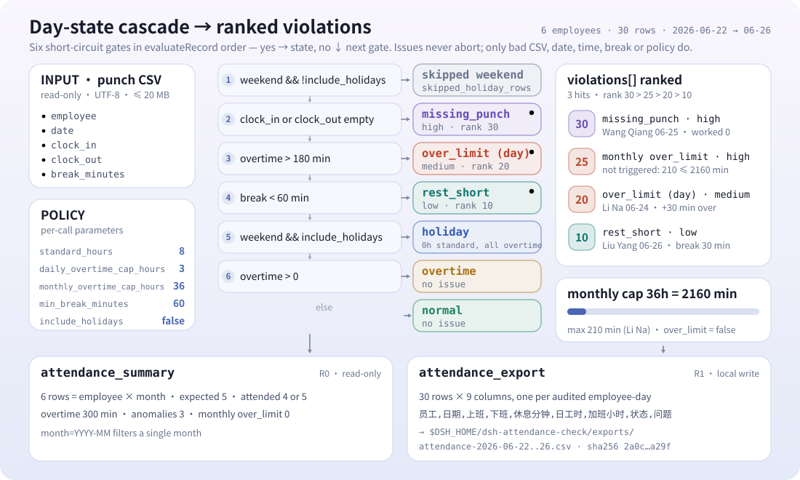
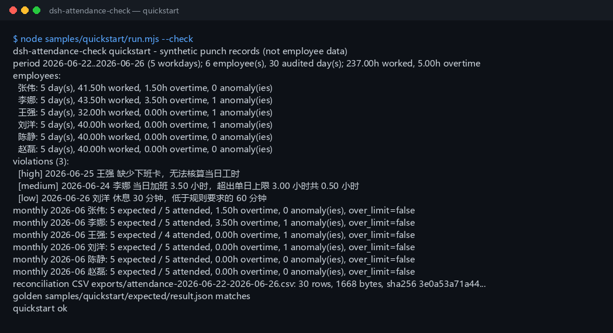

<div align="center">

<picture>
  <source media="(prefers-color-scheme: dark)" srcset="docs/assets/dsh-attendance-check-hero-zh-dark.webp">
  
</picture>

# dsh-attendance-check

**把打卡明细 CSV 核对成每人的日工时、加班、超限日、缺卡与休息不足，按月汇总并导出核对表。**

面向 DeepSeek Harness 的纯本地考勤核对工具：读你指定的打卡 CSV，按 8 小时标准工时、3 小时单日加班上限、36 小时月加班上限逐日核对——不联网、不调用模型、不上传。

[安装](#三步上手) · [配置](#配置) · [FAQ](#faq) · [简体中文](README.md) · [English](README.en.md) · [Español](README.es.md) · [Português](README.pt.md) · [हिन्दी](README.hi.md)

[](LICENSE)
[](#兼容性)
[](https://www.npmjs.com/package/dsh-attendance-check)
[](https://github.com/PerryLink/dsh-attendance-check/actions/workflows/ci.yml)
[](#兼容性)

[](https://github.com/PerryLink/dsh-attendance-check/stargazers)
[](https://www.npmjs.com/package/dsh-attendance-check)
[](https://dshfind.com/plugins/PerryLink/dsh-attendance-check?ref=badge)
[](https://gitee.com/perrylink/dsh-attendance-check)

```sh
dsh plugin --profile <profile> add dsh-attendance-check
```

</div>

<sub>社区插件，与 DeepSeek 官方无关。唯一仓库：<https://github.com/PerryLink/dsh-attendance-check>（Gitee 为镜像）。状态：alpha / 公开合成 / partial / not counted / 非 GA——不含员工数据与客户证据，也不作生产可用、薪酬结算、法律或审计结论声明。</sub>

## 它是什么

导入本地打卡明细（员工、日期、上班时间、下班时间、休息分钟），按标准工时 8 小时、单日加班上限 3 小时、月加班上限 36 小时核对：输出每人的日工时、加班、超限日、缺卡、休息不足，违规清单按严重度排序，再按月汇总并导出核对表 CSV。全部计算在本机完成，源文件只读不改。

- **适合**：几十到几万行的打卡明细；发薪前核对每人每日工时与加班；找出单日加班超过 3 小时、月加班超过 36 小时的员工；把「缺卡」「休息不足」「超限」列成可跟进的清单；给 HR / 财务一份可复核的核对表 CSV；跨零点夜班（`次日 HH:MM` / `24:00+`）的工时计算。
- **不适合**：自动排班、审批加班申请或替代考勤系统；法定节假日日历（本包只识别周六/周日）；多段打卡（一天只支持一对上下班时间）；请假、调休、出差、外勤等假别折算；工资、加班费、个税或社保计算；PDF / 扫描件 / Excel 直接输入（请先导出 CSV）；联网同步打卡机或上传员工数据。

<picture>
  <source media="(prefers-color-scheme: dark)" srcset="docs/assets/dsh-attendance-check-flow-v5-dark.svg">
  
</picture>

## 三步上手

1. **安装**（三选一）：

   ```sh
   # npm 通道（推荐，已发布版本）
   dsh plugin --profile <profile> add dsh-attendance-check
   # git 通道（最新 main）
   dsh plugin --profile <profile> add github:PerryLink/dsh-attendance-check
   # tarball 通道：本仓库 pnpm pack 后
   dsh plugin --profile <profile> add ./dsh-attendance-check-<version>.tgz
   ```

2. **验证已生效**：

   ```sh
   dsh --profile <profile> --dump-config | grep dsh-attendance-check
   ```

3. **跑通自带样例**（6 名员工 × 5 个工作日的合成数据，与金标对比）：

   ```sh
   node samples/quickstart/run.mjs --check
   ```

**卸载**：`dsh plugin --profile <profile> remove dsh-attendance-check`。

## 核心能力

工具名是稳定 API；描述保持英文以匹配运行时输出。

| 工具 | 用途 | 风险 |
|---|---|---|
| `attendance.check` | 读取打卡 CSV，按规则逐日核对，返回每人日工时、加班、超限日、缺卡、休息不足与排序后的违规清单 | R0（只读） |
| `attendance.summary` | 按员工 × 月份汇总应出勤/实出勤/加班合计/异常次数与月超限标记 | R0（只读） |
| `attendance.export` | 把逐日核对表写成 CSV（员工/日期/上班/下班/休息分钟/日工时/加班小时/状态/问题），返回路径与 sha256 | R1（仅本地写 exports 目录） |

- **逐日核对**：日工时 = 下班 − 上班 − 休息；跨零点夜班（`次日 HH:MM` 或 `24:00+`）按次日计算。
- **超限识别**：单日加班超 3 小时记 `over_limit`（medium），月加班超 36 小时记 `over_limit`（high）。
- **缺卡与休息不足**：缺卡是 issue 不是报错；休息不足 60 分钟记 `rest_short`。
- **月度汇总**：每个「员工 × 月份」一行，含应出勤、实出勤、加班合计与月超限标记。
- **可复核交付**：导出中文表头的核对表 CSV，附 `sha256` 回执。

## 示例

直接复制下面这句发给 agent：

> 我有这份 6 名员工 5 个工作日的打卡明细，用 8 小时标准工时、单日加班上限 3 小时、月加班上限 36 小时核对，输出异常清单并导出核对表 CSV。

用自带样例复跑并核对金标：

```sh
node samples/quickstart/run.mjs --check
```



样例是 6 名员工 × 2026-06-22 至 2026-06-26 五个工作日、共 30 条合成打卡：其中 2 个加班日（张伟跨零点 1.5 小时、李娜 3.5 小时超出单日上限 0.5 小时）、1 个缺卡（王强缺下班卡）、1 个休息不足（刘洋只休 30 分钟）。金标 `samples/quickstart/expected/result.json` 由 `node samples/quickstart/run.mjs --json` 真实产生，不是手写；截图是 `--check` 的真实终端输出（原始捕获见 [`docs/assets/quickstart.log`](docs/assets/quickstart.log)）。

## 输入

- 格式：UTF-8 CSV，首行表头，逗号分隔；支持 RFC 4180 引号、嵌入换行、CRLF 与 BOM。
- 表头：`employee,date,clock_in,clock_out,break_minutes`。也接受中文别名 `员工 / 姓名 / 日期 / 上班时间 / 下班时间 / 休息分钟`；大小写不敏感，多出的列会被忽略。
- 日期：`date` 必须是真实存在的 `YYYY-MM-DD`；同一个员工同一天只能有一条记录，重复会报 `E_ATT_CSV_ROW`。
- 时间：`HH:MM`（00:00–23:59）。跨零点写 `次日 01:30`、`次日01:30`，或写成 `24:00`–`29:59`（即 `24:00+`）；下班必须晚于上班，单次当班不超过 24 小时。非法格式报 `E_ATT_TIME_INVALID`。
- 缺卡：`clock_in` 或 `clock_out` 可以为空，空值会变成一条 `E_ATT_MISSING_PUNCH` **问题（issue）**，不会中断整份核对。
- 休息分钟：整数 0–1440；留空视为 0；必须小于上下班之间的时长。非法值报 `E_ATT_BREAK_INVALID`。
- 大小：单个文件 ≤ 20 MB；超过请按员工或月份拆文件。
- 来源：用户自己指定的本地 CSV；原文件只读，不会被修改。

## 输出

- **`attendance.check`**：`{ period, source_sha256, policy, employees, violations, totals }`。
  - `period`：核对覆盖的起止日期、区间内周一至周五天数、涉及月份。
  - `policy`：本次使用的规则（标准工时 / 单日上限 / 月上限 / 最少休息 / 是否含节假日）。
  - `employees[]`：每人的 `days[]`（日期、星期、上下班、休息、日工时、加班、是否节假日、是否跨零点、缺卡方向、状态、问题码）、`worked_minutes`、`overtime_minutes`、`over_limit_days`、`over_limit_months`、`missing_punches`、`rest_short_days`、`skipped_holiday_days` 与按月 `monthly_overtime[]`。
  - `violations[]`：按严重度排序的违规清单；每条含 `severity`、`rank`、`kind`、`scope`、`code`、`employee`、`date`/`month`、`minutes` 与中文 `message`。
  - `totals`：员工数、核对天数、跳过周末行数、总工时、总加班、超限日/月数、缺卡数、休息不足天数、违规总数。
- **`attendance.summary`**：`{ period, source_sha256, policy, rows, totals }`。每个「员工 × 月份」一行：`expected_days`（应出勤）、`attended_days`（实出勤）、`overtime_minutes` / `overtime_hours`（加班合计）、`anomaly_count`（异常次数）、`missing_punches`、`rest_short_days`、`over_limit_days`、`over_limit`（月加班是否超 36h）。可选 `month=YYYY-MM` 只看一个月。
- **`attendance.export`**：把逐日核对表写成 CSV 到 `$DSH_HOME/dsh-attendance-check/exports/`，列固定为 `员工,日期,上班,下班,休息分钟,日工时,加班小时,状态,问题`；返回路径、`sha256`、字节数与行数。文件名只允许 `[A-Za-z0-9._-]`。

## 规则

1. 日工时 = 下班时间 − 上班时间 − 休息分钟；跨零点按次日时间计算。
2. 工作日加班 = max(0, 日工时 − 标准工时分钟)；标准工时默认 8 小时。
3. 单日加班 > 单日上限（默认 3 小时）→ 该日 `over_limit`，违规严重度 `medium`。
4. 月加班合计 > 月上限（默认 36 小时）→ 该员工该月 `over_limit`，违规严重度 `high`；`monthly_overtime[]` 与 summary 的 `over_limit` 同时置位。
5. 缺卡：`clock_in` 或 `clock_out` 为空 → 当日 `missing_punch`，日工时与加班记 0，产生 `E_ATT_MISSING_PUNCH`；**这是 issue，不抛异常**。
6. 休息不足：休息分钟 < 最少休息（默认 60 分钟）→ 当日 `rest_short`，产生 `E_ATT_REST_SHORT`。
7. 周末默认跳过（计入 `skipped_holiday_rows`）；`include_holidays=true` 时周末记录按节假日核对：标准工时为 0，全部已工作分钟计为加班，单日上限仍然生效。
8. 严重度排序：缺卡（30）> 月超限（25）> 单日超限（20）> 休息不足（10）；同级按日期、员工顺序、类型排序。
9. 应出勤 = 文件覆盖区间内该月的周一至周五天数；实出勤 = 有完整上下班打卡的天数。本包不内置法定节假日日历。
10. 月上限按**文件覆盖到的数据**累计，不会自动补齐全月；只核对上传的月份数据。

## 配置

本插件没有 profile 级配置键（`cordis.patch.yml` 只插入插件本身）；所有规则都在每次工具调用时以参数传入，三个工具共用同一套 policy 参数：

| 参数 | 默认值 | 含义 |
|---|---|---|
| `path` | （必填） | 要核对的本地打卡 CSV 路径；只读，不会被修改 |
| `standard_hours` | `8` | 标准工时（小时/日），范围 1–24 |
| `daily_overtime_cap_hours` | `3` | 单日加班上限（小时），范围 0–24 |
| `monthly_overtime_cap_hours` | `36` | 月加班上限（小时），范围 0–744 |
| `min_break_minutes` | `60` | 最少休息分钟，范围 0–720 整数 |
| `include_holidays` | `false` | `true` 时周末记录按节假日核对：标准工时为 0，全部已工作分钟计为加班，单日上限仍然生效 |
| `month` | （空） | 仅 `attendance.summary`：`YYYY-MM`，只看一个月 |
| `filename` | 按期间自动生成 | 仅 `attendance.export`：导出文件名，只允许 `[A-Za-z0-9._-]` |

## FAQ

<details>
<summary>跨零点夜班怎么写？</summary>

下班时间写 `次日 01:30`（可带空格或不带），也可以写扩展小时 `25:30`；两者等价。只写 `01:30` 会被当成同一天凌晨，早于上班时间，报 `E_ATT_TIME_INVALID`。单次当班超过 24 小时同样会报这个码。

</details>

<details>
<summary>缺卡为什么不是报错？</summary>

缺卡在真实考勤里很常见，一次缺卡不应该让整份核对失败。本包把它记成当日 `missing_punch` 加一条 `E_ATT_MISSING_PUNCH` issue，日工时与加班记 0；`attendance.check` 照常返回其他人的结果，方便 HR 逐条补卡后重跑。只有 CSV、日期、时间、休息分钟或规则本身不合法时才会抛异常。

</details>

<details>
<summary>月加班 36 小时怎么判定？</summary>

按员工 + 自然月累计**已核对日**的加班分钟；超过 2160 分钟即 `over_limit=true`，同时产生一条 `scope=month`、`severity=high` 的违规，`minutes` 是超出部分。文件只覆盖半个月时，按半个月的数据累计，不会假设整月都这样。

</details>

<details>
<summary>周末和节假日怎么算？</summary>

本包没有法定节假日日历，只把周六/周日识别为休息日。默认跳过周末打卡；需要核对节假日加班时传 `include_holidays=true`，此时周末的已工作分钟全部算加班，并继续受单日 3 小时上限约束。工作日的法定节假日请先在源数据里标注或剔除。

</details>

<details>
<summary>应出勤和实出勤分别是什么？</summary>

应出勤是文件覆盖区间内该月的周一至周五天数（区间按所有员工的打卡日期取最早到最晚）；实出勤是该员工在该月有完整上下班打卡的天数。缺卡日不算实出勤，但会出现在 `missing_punches` 与违规清单里。

</details>

<details>
<summary>会不会修改或上传我的文件？</summary>

不会。本包只读用户指定的 CSV，只在 `$DSH_HOME/dsh-attendance-check/exports/` 下写核对表，不联网、不调用模型、不上传。源文件不会被改写。

</details>

## 权限与数据

- 读：用户指定的本地打卡 CSV（样例：`samples/quickstart/input/attendance-2026-06.csv`）；不读其他文件。
- 写：仅 `$DSH_HOME/dsh-attendance-check/exports/`（核对表 CSV）；源文件不修改。
- 联网：无。
- 外部系统：无。

`attendance.check` 与 `attendance.summary` 是 **R0**（只读）；`attendance.export` 是 **R1**（只在上述 exports 目录本地写入）。测试可用 `DSH_ATTENDANCE_CHECK_HOME` 覆盖本地写根，默认就是 `$DSH_HOME/dsh-attendance-check`。

## 错误

消息格式为 `<一句人话>（E_ATT_XXX）｜下一步：<一个动作>｜细节：<可选>`。下表 7 个是抛出的错误码，后 3 个是 issue 码（只出现在 `violations`，不中断执行）。

| 代码 | 何时 | 下一步 |
|---|---|---|
| `E_ATT_CSV_ROW` | 列数、表头缺失/重复、员工为空、同一员工同一天重复、文件 > 20 MB | 对照表头修这一行；同一员工同一天只留一条 |
| `E_ATT_DATE_INVALID` | `date` 或 `month` 不是真实日期/月份 | 改成 `2026-06-22` / `2026-06` |
| `E_ATT_TIME_INVALID` | 时间不是 `HH:MM`、跨零点写法不对、下班不晚于上班、当班超过 24 小时 | 用 `09:00`；跨零点用 `次日 01:30` 或 `25:30` |
| `E_ATT_BREAK_INVALID` | 休息分钟不是 0–1440 的整数，或休息吃掉了整个当班时长 | 填整数分钟，且小于上下班之间的时长 |
| `E_ATT_POLICY_INVALID` | 标准工时、单日/月上限、最少休息超出范围 | 标准 1–24h、单日 0–24h、月 0–744h、休息 0–720 整数分钟 |
| `E_ATT_PATH_INVALID` | 输入路径不存在/是目录/读不了，或导出文件名不安全 | 传存在的 CSV；导出名只用 `[A-Za-z0-9._-]` |
| `E_ATT_EMPTY` | 空文件、只有表头、全部是周末且未开 `include_holidays`、月份筛选无数据 | 检查日期与 `include_holidays`；换一个有数据的月份 |
| `E_ATT_MISSING_PUNCH`（issue） | 上班或下班时间为空 | 补卡后重跑；该日暂按 0 工时计 |
| `E_ATT_OVER_LIMIT`（issue） | 单日加班超上限（`scope=day`）或月加班超上限（`scope=month`） | 复核加班审批与调休安排 |
| `E_ATT_REST_SHORT`（issue） | 休息分钟低于规则要求 | 核对午休/晚休记录，或调整 `min_break_minutes` |

详见 [TROUBLESHOOTING.md](TROUBLESHOOTING.md)。

## 已知限制

- **无节假日日历**：只识别周六/周日；中国法定节假日与调休需要先在源数据里处理。
- **一天一对上下班**：不支持多段打卡、加班起止单独记录；请先在考勤系统里合并。
- **无假别**：请假、调休、出差、外勤、旷工不参与折算，缺卡只作为 issue 提示。
- **不结算工资**：不计算加班费、倍率、个税或社保，只输出工时与核对结果。
- **月上限按已覆盖数据**：文件只覆盖部分日期时，36 小时上限只对已核对数据判定。
- CSV 输入输出；不读 PDF / 扫描件 / Excel，不做 OCR。
- 导出的 CSV 只用 RFC 4180 引号；不会清洗 Excel 公式前缀。
- 只在本机运行：无网络、无模型调用、无上传。
- 公开合成样例；alpha/partial，not counted，不作生产可用或合规声明。

## 验收证据

公开合成夹具在 `samples/quickstart/`；`ACCEPTANCE.csv` 记录 17 条工具检查加 1 条 quickstart 金标，共 18 行。除 quickstart 外均为 `counted=false`。

| req_id | metric | threshold | actual | pass | source | counted |
|---|---|---|---|---|---|---|
| AC-A01 | 日核对合计 | employees=6 days=30 overtime=300 | employees=6 days=30 overtime=300 | true | public/synthetic | false |
| AC-A04 | 单日加班上限 | overtime=210 status=over_limit | overtime=210 status=over_limit | true | public/synthetic | false |
| AC-A07 | 月度汇总 | rows=6 expected=30 attended=29 | rows=6 expected=30 attended=29 | true | public/synthetic | false |
| AC-A09 | 月上限 over_limit | monthly=2340 over=180 | monthly=2340 over=180 | true | public/synthetic | false |
| AC-A10 | 核对表 CSV | rows=30 lines=31 hash=ok | rows=30 lines=31 hash=ok | true | public/synthetic | false |
| PS1-QS01 | quickstart golden | 1/1 | 1 | true | synthetic/quickstart | true |

*夹具结果，不是员工或客户数据；输出未手写。* 运行环境与逐命令结果见 [EVIDENCE.md](EVIDENCE.md)，历次证据运行存于 `evidence/`。

## 兼容性

| 面 | 状态 |
|---|---|
| Harness | `dsh >=0.2.1-rc.3 <0.4.0` |
| Node | `>=24.9.0 <25` |
| 平台 | 全平台；只用本地文件 |
| 数据 | 无网络、无模型调用、无上传 |

## 生态与质量

- [Gitee 镜像](https://gitee.com/perrylink/dsh-attendance-check)（同步镜像，以 GitHub 为准）
- [dshfind 插件页](https://dshfind.com/plugins/PerryLink/dsh-attendance-check)（安装量与排名）
- [领域索引](https://perrylink.github.io/dsh-plugins/)（PerryLink 插件总目）
- 同族相关插件：[dsh-ar-aging](https://github.com/PerryLink/dsh-ar-aging)（应收账龄）、[dsh-policy-ledger](https://github.com/PerryLink/dsh-policy-ledger)（制度台账）

## 开发

```sh
pnpm install --frozen-lockfile
pnpm build && pnpm lint && pnpm typecheck
node --test test/*.test.mjs
node scripts/gate.mjs
```

当前版本 `0.1.0` · 134 项测试通过（`node --test test/*.test.mjs`）。配图由 [`scripts/gen-readme-assets.py`](scripts/gen-readme-assets.py) 程序化生成（Python：hero 用 Pillow 绘制、结构图为手写 SVG，均为深浅双版），可重复执行。

Topics：`deepseek-harness`, `dsh`, `dsh-plugin`, `attendance`, `overtime`, `timesheet`, `punch-clock`, `payroll`, `hr`, `csv`, `perrylink`

## 家族与致谢

本项目是 [PerryLink](https://github.com/PerryLink) 维护的 DeepSeek Harness 插件家族成员（全部 Apache-2.0）。如果这个插件帮到了你，**给个 star**——它不解锁任何功能，但会让下一个人更容易找到它。

- [@PerryLink](https://github.com/PerryLink) —— 创建者与维护者：打卡 CSV 核对管线、`attendance.check` / `attendance.summary` / `attendance.export` 三个工具、quickstart 金标样例与验收证据、五语文档。

## License

[LICENSE](LICENSE)（Apache License 2.0）© 2026 dsh-attendance-check contributors。另见 `NOTICE`、`THIRD-PARTY-NOTICES`。

<p align="center"><sub>Apache-2.0 · 社区插件，与 DeepSeek 无关。</sub></p>
