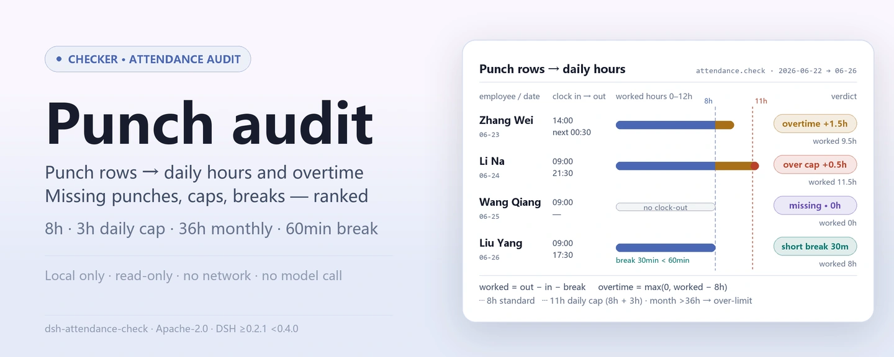
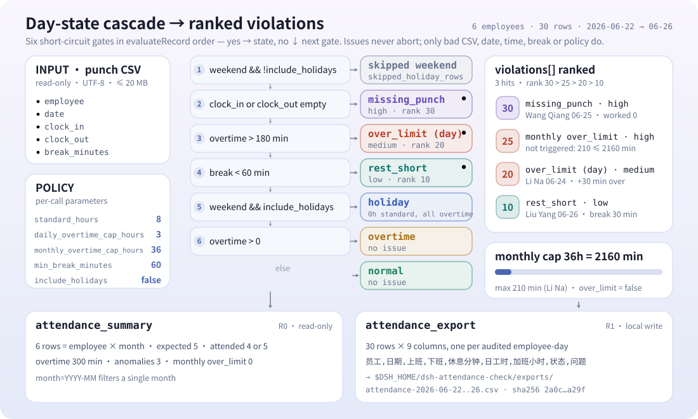
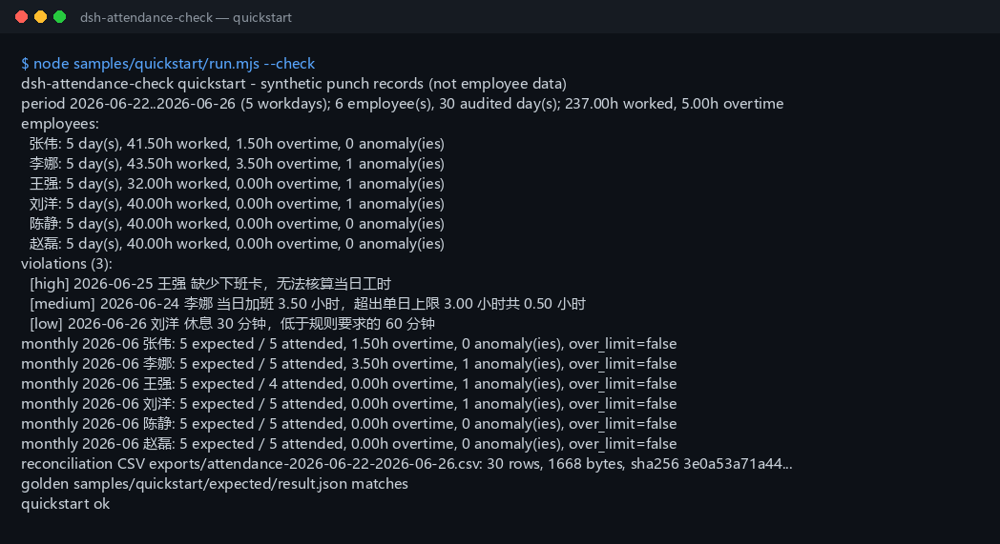

<div align="center">

<picture>
  <source media="(prefers-color-scheme: dark)" srcset="docs/assets/dsh-attendance-check-hero-en-dark.webp">
  
</picture>

# dsh-attendance-check

**Transforme um CSV de ponto em horas diárias, horas extras, dias acima do limite, marcações faltantes e intervalos insuficientes por funcionário; depois consolide o mês e exporte um CSV de reconciliação.**

Uma ferramenta de auditoria de ponto puramente local para o DeepSeek Harness: lê o CSV de ponto que você indicar e audita cada dia contra uma jornada padrão de 8 horas, um teto de 3 horas extras diárias e um teto de 36 horas extras mensais — sem rede, sem chamadas a modelos e sem upload.

[Instalar](#instalação-em-três-passos) · [Configuração](#configuração) · [FAQ](#faq) · [简体中文](README.md) · [English](README.en.md) · [Español](README.es.md) · [Português](README.pt.md) · [हिन्दी](README.hi.md)

[](LICENSE)
[](#compatibilidade)
[](https://www.npmjs.com/package/dsh-attendance-check)
[](https://github.com/PerryLink/dsh-attendance-check/actions/workflows/ci.yml)
[](#compatibilidade)

[](https://github.com/PerryLink/dsh-attendance-check/stargazers)
[](https://www.npmjs.com/package/dsh-attendance-check)
[](https://dshfind.com/plugins/PerryLink/dsh-attendance-check?ref=badge)
[](https://gitee.com/perrylink/dsh-attendance-check)

```sh
dsh plugin --profile <profile> add dsh-attendance-check
```

</div>

<sub>Plugin da comunidade, sem afiliação com a DeepSeek. Repositório canônico: <https://github.com/PerryLink/dsh-attendance-check> (o Gitee é um espelho). Status: alfa / sintético-público / parcial / not counted / não GA — sem dados de funcionários nem evidências de clientes, e sem declarações de prontidão para produção, liquidação de folha, legais ou de auditoria.</sub>

## O que é

Importa um registro local de ponto (funcionário, data, entrada, saída, minutos de intervalo), audita-o contra uma jornada padrão de 8 horas, um teto de 3 horas extras diárias e um teto de 36 horas extras mensais, e devolve as horas diárias, horas extras, dias acima do limite, marcações faltantes e intervalos insuficientes de cada funcionário, uma lista de infrações ordenada por gravidade, um resumo mensal e um CSV de reconciliação. Tudo roda na sua máquina; o arquivo de origem é somente leitura e nunca é modificado.

- **Serve para:** dezenas até dezenas de milhares de linhas de ponto; conferir horas diárias e extras antes da folha; encontrar funcionários acima do teto diário de 3 horas ou do teto mensal de 36 horas; transformar marcações faltantes, intervalos insuficientes e dias acima do limite numa lista de acompanhamento; entregar ao RH ou ao financeiro um CSV de reconciliação revisável; turnos que cruzam a meia-noite escritos como `次日 HH:MM` ou `24:00+`.
- **Não serve para:** escalonamento de turnos, aprovação de horas extras ou substituição de um sistema de ponto; calendário de feriados oficiais (apenas sábado e domingo são reconhecidos); múltiplos pares de marcações por dia; conversão de licenças, compensações, viagens ou trabalho externo; cálculo de salários, pagamento de horas extras, impostos ou previdência; PDF, digitalizações ou Excel como entrada direta (exporte para CSV primeiro); sincronizar um relógio de ponto ou enviar dados de funcionários.

<picture>
  <source media="(prefers-color-scheme: dark)" srcset="docs/assets/dsh-attendance-check-flow-v5-dark.svg">
  
</picture>

## Instalação em três passos

1. **Instale** (escolha um canal):

   ```sh
   # canal npm (recomendado, versões publicadas)
   dsh plugin --profile <profile> add dsh-attendance-check
   # canal git (main mais recente)
   dsh plugin --profile <profile> add github:PerryLink/dsh-attendance-check
   # canal tarball: pnpm pack neste repositório e depois
   dsh plugin --profile <profile> add ./dsh-attendance-check-<version>.tgz
   ```

2. **Verifique que está ativo**:

   ```sh
   dsh --profile <profile> --dump-config | grep dsh-attendance-check
   ```

3. **Execute o exemplo incluído** (6 funcionários × 5 dias úteis de dados sintéticos, comparado com o arquivo-ouro):

   ```sh
   node samples/quickstart/run.mjs --check
   ```

**Desinstalar:** `dsh plugin --profile <profile> remove dsh-attendance-check`.

## Capacidades principais

Os nomes das ferramentas são API estável; as descrições permanecem em inglês para corresponder à saída em tempo de execução.

| Ferramenta | Finalidade | Risco |
|---|---|---|
| `attendance.check` | Lê o CSV de ponto e audita cada dia: horas diárias, horas extras, dias acima do limite, marcações faltantes, intervalos insuficientes e uma lista de infrações ordenada por gravidade | R0 (somente leitura) |
| `attendance.summary` | Consolida por funcionário-mês os dias esperados/comparecidos, horas extras, contagem de anomalias e a marca de excesso mensal | R0 (somente leitura) |
| `attendance.export` | Grava o CSV de reconciliação em nível de dia (funcionário/data/entrada/saída/intervalo/horas/extras/status/ocorrência), devolvendo caminho e sha256 | R1 (escrita local apenas em exports) |

- **Auditoria diária:** horas do dia = saída − entrada − intervalo; turnos que cruzam a meia-noite (`次日 HH:MM` ou `24:00+`) são computados no dia seguinte.
- **Detecção de excessos:** mais de 3 horas extras num dia marca o dia `over_limit` (medium); mais de 36 horas extras no mês marca o funcionário-mês `over_limit` (high).
- **Marcações faltantes e intervalos curtos:** uma marcação faltante é uma ocorrência, não um erro; um intervalo abaixo de 60 minutos marca o dia `rest_short`.
- **Resumo mensal:** uma linha por funcionário-mês com dias esperados, dias comparecidos, total de horas extras e a marca de excesso mensal.
- **Entregável revisável:** o CSV de reconciliação exportado usa cabeçalhos em chinês e volta com um recibo `sha256`.

## Exemplo

Cole esta linha no agente:

> 我有这份 6 名员工 5 个工作日的打卡明细，用 8 小时标准工时、单日加班上限 3 小时、月加班上限 36 小时核对，输出异常清单并导出核对表 CSV。

Reproduza o exemplo incluído e compare com o arquivo-ouro:

```sh
node samples/quickstart/run.mjs --check
```



O exemplo é de 6 funcionários × 5 dias úteis (2026-06-22 a 2026-06-26), 30 marcações sintéticas: 2 dias com horas extras (Zhang Wei trabalha 1,5 h cruzando a meia-noite; Li Na trabalha 3,5 h e excede o teto diário em 0,5 h), 1 marcação faltante (Wang Qiang não tem saída) e 1 intervalo insuficiente (Liu Yang faz apenas 30 minutos). `samples/quickstart/expected/result.json` é a saída real de `node samples/quickstart/run.mjs --json`, não escrita à mão; a captura de tela é a saída real de terminal do `--check` (captura bruta em [`docs/assets/quickstart.log`](docs/assets/quickstart.log)).

## Entrada

- CSV UTF-8 com linha de cabeçalho e separador por vírgula. São suportados aspas RFC 4180, quebras de linha embutidas, CRLF e BOM UTF-8.
- Cabeçalho: `employee,date,clock_in,clock_out,break_minutes`. Os aliases chineses (`员工 / 姓名 / 日期 / 上班时间 / 下班时间 / 休息分钟`) também funcionam; a correspondência não diferencia maiúsculas e colunas extras são ignoradas.
- Datas: `date` deve ser um `YYYY-MM-DD` real. Uma linha por funcionário por dia; duplicatas são `E_ATT_CSV_ROW`.
- Horários: `HH:MM` (00:00–23:59). Para cruzar a meia-noite use `次日 01:30`, `次日01:30`, ou as horas estendidas `24:00`–`29:59` (a forma `24:00+`); a saída deve ser posterior à entrada e um turno não pode exceder 24 horas. Formatos inválidos são `E_ATT_TIME_INVALID`.
- Marcações faltantes: `clock_in` ou `clock_out` podem estar vazios. Um valor vazio vira uma **ocorrência** `E_ATT_MISSING_PUNCH`, não uma interrupção.
- Minutos de intervalo: inteiro 0–1440; vazio significa 0; deve ser menor que a duração do turno. Valores inválidos são `E_ATT_BREAK_INVALID`.
- Tamanho: até 20 MB por arquivo; acima disso, divida por funcionário ou por mês.
- Origem: o CSV local indicado pelo usuário; é somente leitura e nunca é modificado.

## Saída

- **`attendance.check`**: `{ period, source_sha256, policy, employees, violations, totals }`.
  - `period`: datas cobertas, dias úteis segunda–sexta dentro do intervalo, meses tocados.
  - `policy`: as regras usadas (horas padrão, teto diário, teto mensal, intervalo mínimo, feriados incluídos).
  - `employees[]`: por funcionário, `days[]` (data, dia da semana, marcações, intervalo, minutos trabalhados, horas extras, marca de feriado, marca de cruzamento de meia-noite, lado faltante, status, códigos de ocorrência), `worked_minutes`, `overtime_minutes`, `over_limit_days`, `over_limit_months`, `missing_punches`, `rest_short_days`, `skipped_holiday_days` e `monthly_overtime[]`.
  - `violations[]`: infrações ordenadas por gravidade com `severity`, `rank`, `kind`, `scope`, `code`, `employee`, `date`/`month`, `minutes` e uma `message` em chinês.
  - `totals`: funcionários, dias auditados, linhas de fim de semana ignoradas, minutos trabalhados e extras, dias/meses acima do limite, marcações faltantes, dias com intervalo insuficiente e total de infrações.
- **`attendance.summary`**: `{ period, source_sha256, policy, rows, totals }`. Uma linha por funcionário-mês: `expected_days`, `attended_days`, `overtime_minutes` / `overtime_hours`, `anomaly_count`, `missing_punches`, `rest_short_days`, `over_limit_days` e `over_limit` (horas extras mensais acima de 36 h). Filtro opcional `month=YYYY-MM`.
- **`attendance.export`**: grava o CSV de reconciliação em nível de dia em `$DSH_HOME/dsh-attendance-check/exports/` com as colunas `员工,日期,上班,下班,休息分钟,日工时,加班小时,状态,问题`; devolve caminho, `sha256`, bytes e contagem de linhas. O nome do arquivo só aceita `[A-Za-z0-9._-]`.

## Regras

1. Horas do dia = saída − entrada − intervalo; horários que cruzam a meia-noite são computados no dia seguinte.
2. Horas extras de dia útil = max(0, minutos do dia − minutos padrão); o padrão é 8 horas.
3. Mais de 3 horas extras num dia marca o dia `over_limit` com gravidade `medium`.
4. Mais de 36 horas extras no mês marca o funcionário-mês `over_limit` com gravidade `high`; tanto `monthly_overtime[]` quanto a marca `over_limit` do resumo são ativadas.
5. Entrada ou saída vazia marca o dia `missing_punch`, conta 0 minutos trabalhados e emite `E_ATT_MISSING_PUNCH` como **ocorrência**, nunca como erro lançado.
6. Um intervalo abaixo do mínimo (60 minutos por padrão) marca o dia `rest_short` e emite `E_ATT_REST_SHORT`.
7. Linhas de sábado/domingo são ignoradas por padrão (contadas em `skipped_holiday_rows`). Com `include_holidays=true`, as linhas de fim de semana são auditadas como trabalho em feriado: tempo padrão 0, todos os minutos trabalhados contam como horas extras e o teto diário continua valendo.
8. Ordem de gravidade: marcação faltante (30) > excesso mensal (25) > excesso diário (20) > intervalo insuficiente (10); empates são resolvidos por data, ordem do funcionário e tipo.
9. Dias esperados = dias segunda–sexta do intervalo coberto daquele mês; dias comparecidos = dias com ambas as marcações. Não há calendário de feriados oficiais embutido.
10. O teto mensal aplica-se aos dados presentes no arquivo; não preenche o restante do mês.

## Configuração

Este plugin não tem chaves de configuração em nível de perfil (`cordis.patch.yml` apenas insere o próprio plugin); cada regra é passada como argumento da ferramenta em cada chamada, e as três ferramentas compartilham os mesmos parâmetros de política:

| Parâmetro | Padrão | Significado |
|---|---|---|
| `path` | (obrigatório) | CSV de ponto local a auditar; somente leitura, nunca modificado |
| `standard_hours` | `8` | Horas padrão por dia, faixa 1–24 |
| `daily_overtime_cap_hours` | `3` | Teto de horas extras diárias, faixa 0–24 |
| `monthly_overtime_cap_hours` | `36` | Teto de horas extras mensais, faixa 0–744 |
| `min_break_minutes` | `60` | Minutos mínimos de intervalo, inteiro 0–720 |
| `include_holidays` | `false` | Com `true`, as linhas de fim de semana são auditadas como trabalho em feriado: tempo padrão 0, todos os minutos trabalhados contam como horas extras e o teto diário continua valendo |
| `month` | (vazio) | Apenas `attendance.summary`: `YYYY-MM`, olhar um único mês |
| `filename` | derivado do período | Apenas `attendance.export`: nome do arquivo exportado, apenas `[A-Za-z0-9._-]` |

## FAQ

<details>
<summary>Como escrevo um turno que cruza a meia-noite?</summary>

Escreva `次日 01:30` (com ou sem espaço) ou a forma estendida `25:30`; são equivalentes. Um simples `01:30` é tratado como madrugada do mesmo dia, anterior à entrada, e lança `E_ATT_TIME_INVALID`. Um turno com mais de 24 horas lança o mesmo código.

</details>

<details>
<summary>Por que uma marcação faltante não é um erro?</summary>

Marcações faltantes são rotineiras em dados de ponto reais e uma única marcação faltante não deve derrubar toda a reconciliação. Ela é registrada como um dia `missing_punch` mais uma ocorrência `E_ATT_MISSING_PUNCH`, com 0 minutos trabalhados e 0 horas extras; `attendance.check` continua devolvendo os resultados dos demais para que o RH corrija a marcação e rode de novo. Só abortam a chamada CSV, datas, horários, intervalos ou regras malformados.

</details>

<details>
<summary>Como o teto mensal de 36 horas é decidido?</summary>

Os minutos extras são somados por funcionário e mês civil sobre os dias auditados; acima de 2160 minutos `over_limit=true`, e uma infração `scope=month`, `severity=high` é emitida com `minutes` igual ao excesso. Se o arquivo cobre apenas metade do mês, só os dados auditados são contados; a ferramenta não extrapola.

</details>

<details>
<summary>Como fins de semana e feriados são tratados?</summary>

Não há calendário de feriados oficiais: apenas sábado e domingo são reconhecidos como dias de descanso. Linhas de fim de semana são ignoradas por padrão; passe `include_holidays=true` para auditar trabalho no fim de semana, em que todos os minutos trabalhados contam como horas extras e o teto diário continua valendo. Marque ou remova primeiro os feriados oficiais em dia de semana nos dados de origem.

</details>

<details>
<summary>O que são dias esperados e dias comparecidos?</summary>

Dias esperados são os dias segunda–sexta dentro do intervalo coberto do arquivo para aquele mês (o intervalo vai da data auditada mais cedo à mais tarde entre todos os funcionários). Dias comparecidos são os dias com ambas as marcações presentes para aquele funcionário. Um dia com marcação faltante não conta como comparecido, mas aparece em `missing_punches` e na lista de infrações.

</details>

<details>
<summary>Ele modifica ou envia o meu arquivo?</summary>

Não. Ele lê o CSV indicado, escreve apenas em `$DSH_HOME/dsh-attendance-check/exports/` e nunca usa rede, chamada a modelo ou upload. O CSV de origem não é modificado.

</details>

## Permissões e dados

- Leitura: o CSV de ponto indicado pelo usuário (exemplo: `samples/quickstart/input/attendance-2026-06.csv`); nada mais.
- Escrita: apenas `$DSH_HOME/dsh-attendance-check/exports/` (o CSV de reconciliação); o arquivo de origem não é modificado.
- Rede: não.
- Sistemas externos: nenhum.

`attendance.check` e `attendance.summary` são **R0** (somente leitura). `attendance.export` é **R1** (escrita local apenas na pasta exports). `DSH_ATTENDANCE_CHECK_HOME` substitui a raiz de escrita local para testes; o padrão é exatamente `$DSH_HOME/dsh-attendance-check`.

## Erros

O formato da mensagem é `<uma frase>（E_ATT_XXX）｜下一步：<uma ação>｜细节：<opcional>`. Os primeiros sete códigos são lançados; os três últimos são códigos de ocorrência que só aparecem em `violations`.

| Código | Quando | Próxima ação |
|---|---|---|
| `E_ATT_CSV_ROW` | Número de colunas errado, cabeçalho ausente/duplicado, funcionário vazio, funcionário-dia duplicado, arquivo > 20 MB | Corrija a linha indicada; uma linha por funcionário por dia |
| `E_ATT_DATE_INVALID` | `date` ou `month` não é uma data/mês real | Use `2026-06-22` / `2026-06` |
| `E_ATT_TIME_INVALID` | Não é `HH:MM`, forma de cruzamento de meia-noite errada, saída não posterior à entrada, turno > 24 h | Use `09:00`; cruze a meia-noite com `次日 01:30` ou `25:30` |
| `E_ATT_BREAK_INVALID` | O intervalo não é um inteiro 0–1440 ou consome todo o turno | Minutos inteiros menores que a duração do turno |
| `E_ATT_POLICY_INVALID` | Horas padrão, tetos ou intervalo mínimo fora da faixa | Padrão 1–24 h, diário 0–24 h, mensal 0–744 h, intervalo 0–720 minutos inteiros |
| `E_ATT_PATH_INVALID` | Entrada ausente/diretório/ilegível ou nome de exportação inseguro | Passe um CSV existente; exporte apenas com `[A-Za-z0-9._-]` |
| `E_ATT_EMPTY` | Arquivo vazio, só cabeçalho, tudo fim de semana sem `include_holidays`, ou filtro de mês sem dados | Verifique as datas e `include_holidays`; escolha um mês com dados |
| `E_ATT_MISSING_PUNCH` (ocorrência) | Entrada ou saída vazia | Corrija a marcação e rode de novo; o dia conta 0 horas por enquanto |
| `E_ATT_OVER_LIMIT` (ocorrência) | Teto diário excedido (`scope=day`) ou teto mensal excedido (`scope=month`) | Revise a aprovação de horas extras e o planejamento de compensações |
| `E_ATT_REST_SHORT` (ocorrência) | Intervalo abaixo do mínimo da política | Verifique o registro de intervalos ou ajuste `min_break_minutes` |

Veja [TROUBLESHOOTING.md](TROUBLESHOOTING.md).

## Limitações conhecidas

- **Sem calendário de feriados:** apenas sábado/domingo são reconhecidos; feriados oficiais e dias compensatórios devem ser preparados nos dados de origem.
- **Um par de marcações por dia:** sem marcações multissegmento nem registros separados de início/fim de horas extras; consolide-as primeiro no sistema de origem.
- **Sem tipos de licença:** licenças, compensações, viagens, trabalho externo e ausências não são convertidos; uma marcação faltante é apenas uma ocorrência.
- **Sem folha de pagamento:** sem pagamento de horas extras, multiplicadores, impostos ou previdência; o pacote reporta apenas horas e resultados de reconciliação.
- **Teto mensal limitado aos dados:** se o arquivo cobre parte de um mês, o teto de 36 horas aplica-se apenas aos dados auditados.
- Apenas CSV: sem PDF, digitalizações ou Excel, e sem OCR.
- O CSV exportado usa apenas aspas RFC 4180; prefixos de fórmula do Excel não são higienizados.
- Apenas local: sem rede, sem chamadas a modelos, sem upload.
- Apenas amostras públicas/sintéticas; alfa/parcial, not counted, sem declaração de prontidão para produção ou conformidade.

## Evidência de aceitação

Os acessórios públicos/sintéticos vivem em `samples/quickstart/`; `ACCEPTANCE.csv` registra 17 verificações de ferramentas mais uma linha-ouro de quickstart (18 linhas). Todas as linhas são `counted=false` exceto a de quickstart.

| req_id | metric | threshold | actual | pass | source | counted |
|---|---|---|---|---|---|---|
| AC-A01 | daily audit totals | employees=6 days=30 overtime=300 | employees=6 days=30 overtime=300 | true | public/synthetic | false |
| AC-A04 | daily overtime cap | overtime=210 status=over_limit | overtime=210 status=over_limit | true | public/synthetic | false |
| AC-A07 | monthly summary | rows=6 expected=30 attended=29 | rows=6 expected=30 attended=29 | true | public/synthetic | false |
| AC-A09 | monthly cap over_limit | monthly=2340 over=180 | monthly=2340 over=180 | true | public/synthetic | false |
| AC-A10 | reconciliation CSV | rows=30 lines=31 hash=ok | rows=30 lines=31 hash=ok | true | public/synthetic | false |
| PS1-QS01 | quickstart golden | 1/1 | 1 | true | synthetic/quickstart | true |

*Linhas respaldadas por acessórios, não dados de funcionários ou clientes; nenhuma saída é inventada.* Veja [EVIDENCE.md](EVIDENCE.md) para o ambiente e os resultados por comando; execuções de evidência anteriores vivem em `evidence/`.

## Compatibilidade

| Superfície | Status |
|---|---|
| Harness | `dsh >=0.2.1-rc.3 <0.4.0` |
| Node | `>=24.9.0 <25` |
| Plataformas | Todas; apenas arquivos locais |
| Dados | Sem rede, sem chamadas a modelos, sem upload |

## Ecossistema e qualidade

- [Espelho no Gitee](https://gitee.com/perrylink/dsh-attendance-check) (espelho sincronizado; o GitHub é o canônico)
- [Página do plugin no dshfind](https://dshfind.com/plugins/PerryLink/dsh-attendance-check) (instalações e classificação)
- [Índice de domínio](https://perrylink.github.io/dsh-plugins/) (o catálogo de plugins da PerryLink)
- Plugins relacionados da família: [dsh-ar-aging](https://github.com/PerryLink/dsh-ar-aging) (aging de contas a receber), [dsh-policy-ledger](https://github.com/PerryLink/dsh-policy-ledger) (livro-razão de políticas)

## Desenvolvimento

```sh
pnpm install --frozen-lockfile
pnpm build && pnpm lint && pnpm typecheck
node --test test/*.test.mjs
node scripts/gate.mjs
```

Versão atual `0.1.0` · 134 testes aprovados (`node --test test/*.test.mjs`). As imagens do README são geradas programaticamente por [`scripts/gen-readme-assets.py`](scripts/gen-readme-assets.py) (Python: o hero é desenhado com Pillow e o diagrama de estrutura é um SVG escrito à mão; ambos em variante clara e escura) e pode ser reexecutado a qualquer momento.

Tópicos: `deepseek-harness`, `dsh`, `dsh-plugin`, `attendance`, `overtime`, `timesheet`, `punch-clock`, `payroll`, `hr`, `csv`, `perrylink`

## Família e agradecimentos

Este projeto é membro da família de plugins do DeepSeek Harness mantida por [PerryLink](https://github.com/PerryLink) (todos Apache-2.0). Se este plugin ajudar você, **uma estrela facilita que a próxima pessoa o encontre** — nada fica bloqueado atrás dela.

- [@PerryLink](https://github.com/PerryLink) — criador e mantenedor: o pipeline de auditoria do CSV de ponto, as três ferramentas `attendance.check` / `attendance.summary` / `attendance.export`, o exemplo-ouro de quickstart com sua evidência de aceitação e a documentação em cinco idiomas.

## Licença

[LICENSE](LICENSE) (Apache License 2.0) © 2026 dsh-attendance-check contributors. Veja também `NOTICE` e `THIRD-PARTY-NOTICES`.

<p align="center"><sub>Apache-2.0 · Plugin da comunidade, sem afiliação com a DeepSeek.</sub></p>
